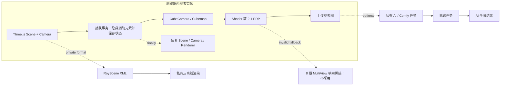

# `3vj-js` 静态参考实现审阅报告

> 分析日期：2026-08-24
> 分析方式：本地只读静态分析
> 核心结论：该 Bundle 能验证 Three.js 结构全景与 AI 增强分层，但不能作为自主方案的直接代码或服务依赖。

## 1. Scope 摘要

| 项目 | 内容 |
|---|---|
| 目标 | `C:\Users\Administrator\.local\share\TeleAgent\TeleAgent的工作空间\.temp\3vj-js` |
| 用户目标 | 判断该实现是否能帮助完善“户型图 → 3D → AI 360°全景”方案，并提炼可执行 TODO |
| 分析范围 | 18 个本地 JavaScript Bundle；模块指纹、全景捕获、AI 调用边界、私有依赖和可复用行为 |
| 未执行事项 | 未运行未知业务代码，未访问网络接口，未进行登录、Hook 或动态请求采样 |
| 工具 | PowerShell 7、`rg`、Node.js 22（仅确认运行时可用；未执行目标 Bundle） |

目录没有 `scope.md` 或 `timeline.md`，本报告直接记录本次用户指定范围和关键时间线。

## 2. 执行摘要

`3vj-js` 不是 Google 3D 引擎，也不是一个可直接安装的开源项目。它是一个压缩后的 3VJIA 前端产物，内置 Three.js r171，并实现了浏览器内 Cubemap → Equirectangular 捕获；随后才把参考图提交给独立 AI 任务。其高质量离线渲染、配置、AI 和图册查询又依赖私有域名、接口及 RoyScene 格式。

因此可采用的不是 Bundle 本身，而是四个行为约束：

- 结构全景与 AI 精渲严格分层；
- 捕获期间事务化保存并恢复场景、相机和渲染器状态；
- 全景输入必须携带明确的投影、方向、尺寸与色彩空间元数据；
- WebGL2 失败时仍走六面 Cubemap 的正确球面转换，不复制 8 段透视图横向拼接。

## 3. Evidence

### E-001：目标快照与文件指纹

- `source_type`: file / command
- `source_ref`: `3vj-js/*.js`
- `content_hash`: 关键文件 Hash 见下表
- `linked_workitem`: P0-15
- `supersedes`: none

| 文件 | SHA256 |
|---|---|
| `vendors.dc7ce51b1e10e517b483.js` | `5334593A45C74597D01FB32F017C9116F128CE6B0B768539465D17CA5B65CDCB` |
| `4501.6dad8ed5.js` | `0FE0DDDC8A22DE87F6E7713648CF8CCF4989C4DDC3C3A90031537E414D3DF450` |
| `7866.1fb884be.js` | `5B1349E1101747D385C09EFCCE2EFF75017118BC40D057B6794B2EBE43EE848A` |
| `index.edd5a9fc733e8849ea23.js` | `5EB748D0BB79ACBD03D1B10937AFDCB1DF3B80D4A95853A8431CF25DAD2F123F` |

```powershell
$target = 'C:\Users\Administrator\.local\share\TeleAgent\TeleAgent的工作空间\.temp\3vj-js'
Get-ChildItem -LiteralPath $target -Filter '*.js' |
  Measure-Object -Property Length -Sum
Get-FileHash -Algorithm SHA256 -LiteralPath `
  "$target\vendors.dc7ce51b1e10e517b483.js", `
  "$target\4501.6dad8ed5.js", `
  "$target\7866.1fb884be.js", `
  "$target\index.edd5a9fc733e8849ea23.js"
rg --files $target -g '*.map'
```

观察结果：18 个 Bundle，合计 21,211,546 bytes；没有 Source Map、源码仓库元数据或独立许可证文件。

### E-002：Three.js 与本地 ERP 捕获

- `source_type`: file
- `source_ref`: `vendors.dc7ce51b1e10e517b483.js`，Webpack 模块 `67869`、`20439`
- `content_hash`: `5334593A45C74597D01FB32F017C9116F128CE6B0B768539465D17CA5B65CDCB`
- `linked_workitem`: P0-07、P0-15
- `supersedes`: none

可复现定位：

```powershell
$bundle = Get-Content -LiteralPath "$target\vendors.dc7ce51b1e10e517b483.js" -Raw
@(
  'const i="171"',
  '20439:function(',
  'generateEquirectangularWithShader',
  'WebGLCubeRenderTarget',
  'readRenderTargetPixels',
  'CubeCamera'
) | ForEach-Object { "$_ => $($bundle.IndexOf($_))" }
```

关键观察：模块 `20439` 使用 Cubemap Render Target、CubeCamera、全屏 Shader 和 `readRenderTargetPixels` 生成严格 2:1 ERP；同时包含 ERP ↔ Cubemap 和 ERP → Perspective Thumbnail 的像素转换。

### E-003：结构捕获与 AI 任务是两个阶段

- `source_type`: file
- `source_ref`: `4501.6dad8ed5.js` 模块 `79162`；`7866.1fb884be.js` 模块 `14181`
- `content_hash`: `0FE0DDDC8A22DE87F6E7713648CF8CCF4989C4DDC3C3A90031537E414D3DF450`、`5B1349E1101747D385C09EFCCE2EFF75017118BC40D057B6794B2EBE43EE848A`
- `linked_workitem`: P0-09
- `supersedes`: none

```powershell
$capture = Get-Content -LiteralPath "$target\4501.6dad8ed5.js" -Raw
$gateway = Get-Content -LiteralPath "$target\7866.1fb884be.js" -Raw
@('generateFisheyeImage', 'generateEquirectangular', 'fisheyeBase64') |
  ForEach-Object { "capture: $_ => $($capture.IndexOf($_))" }
@('comfy-2d3d-natural', 'aiDrawImage', 'queryImageInfo') |
  ForEach-Object { "gateway: $_ => $($gateway.IndexOf($_))" }
```

关键观察：前端先用当前 Scene/Camera/Renderer 生成约 2048 级 ERP JPEG，上传后把 URL 作为 `fisheyeBase64` 传入 AI 任务；任务类型为 `comfy-2d3d-natural`，结果通过独立任务接口轮询。字段名“fisheye”与实际 2:1 ERP 投影不一致。

### E-004：捕获事务与状态恢复

- `source_type`: file
- `source_ref`: `7866.1fb884be.js` 模块 `14181`；`vendors.dc7ce51b1e10e517b483.js` 模块 `20439`
- `content_hash`: 同 E-002、E-003
- `linked_workitem`: P0-07
- `supersedes`: none

```powershell
@(
  'withAiReferenceCaptureScene',
  'prepareAiReferenceCaptureScene',
  'restoreAiReferenceCaptureScene',
  'captureRendererState',
  'restoreRendererState',
  'disposeShaderResources'
) | ForEach-Object {
  "$_ => gateway=$($gateway.IndexOf($_)); vendor=$($bundle.IndexOf($_))"
}
```

关键观察：实现会在捕获前调整轮廓和辅助边，支持嵌套事务深度，并在 `finally` 路径恢复；全景生成器另行保存 Camera、Renderer、RenderTarget 并提供 GPU 资源释放。

### E-005：私有依赖与无效 MultiView 降级

- `source_type`: file
- `source_ref`: `vendors.dc7ce51b1e10e517b483.js` 模块 `20439`；`7866.1fb884be.js`
- `content_hash`: 同 E-002、E-003
- `linked_workitem`: P0-07、P0-15
- `supersedes`: none

```powershell
@(
  'generateEquirectangularWithMultiView',
  'drawImage(this.renderer.domElement',
  'RoyScene',
  '3vjia.com',
  '/api/njvr/'
) | ForEach-Object {
  "$_ => vendor=$($bundle.IndexOf($_)); gateway=$($gateway.IndexOf($_))"
}
```

关键观察：`multiView` 默认 8 段，把各透视画面直接绘制到目标 Canvas 横向区间，未做逐像素球面重投影；同一 Bundle 还包含私有域名、AI 接口、RoyScene XML、渲染队列和云端图册协议。

### E-006：任务恢复模式与轮询反例

- `source_type`: file
- `source_ref`: `7866.1fb884be.js`、`9576.8193a238.js`、`vendors.dc7ce51b1e10e517b483.js`
- `content_hash`: 同 E-001
- `linked_workitem`: P0-10、P0-11、P0-13
- `supersedes`: none

```powershell
$task = Get-Content -LiteralPath "$target\9576.8193a238.js" -Raw
@('successCount', 'failedCount', 'failures') |
  ForEach-Object { "partial: $_ => $($task.IndexOf($_))" }
@('timeout:18e5', '_heartBeatInterval', 'lifecycleEpoch') |
  ForEach-Object { "gateway: $_ => $($gateway.IndexOf($_))" }
@('setTimeout(a,2e4)', 'getTargetAtlasUrl') |
  ForEach-Object { "vendor: $_ => $($bundle.IndexOf($_))" }
```

关键观察：Bundle 同时存在可借鉴的部分成功计数、5 秒 Heartbeat、生命周期 Epoch/旧结果抑制，也存在 30 分钟业务 HTTP 和每 20 秒无总截止时间轮询。自主实现应保留前者，禁止后者。

### E-007：门窗矩形与开启方向算法

- `source_type`: file
- `source_ref`: `7866.1fb884be.js` 模块 `48117`
- `content_hash`: `5B1349E1101747D385C09EFCCE2EFF75017118BC40D057B6794B2EBE43EE848A`
- `linked_workitem`: P0-04
- `supersedes`: none

```powershell
$bundle = Get-Content -LiteralPath '<3vj-js>\7866.1fb884be.js' -Raw
@('makeDoorRects', 'makeWindowRects', 'checkSingleDoorOriginPoint') |
  ForEach-Object { "$_ => $($bundle.IndexOf($_))" }
```

关键观察：`makeDoorRects` 过滤 80～450mm 墙矩形短边，要求反向法线对边距离至少 500mm、投影重叠至少 50mm，并去除被包含的重复候选；`makeWindowRects` 把 350mm 范围内的共线窗线聚类成包围盒；`checkSingleDoorOriginPoint` 选择与门实体点距离离散度最小的包围盒顶点作为开启原点。

### E-008：AI 风格配置、字段分层与回退行为

- `source_type`: file + public_config
- `source_ref`: `7866.1fb884be.js`；`https://3vj-pano.3vjia.com/vr/config/aidesk/aidrawcfg20250427.json`
- `content_hash`: Bundle `5B1349E1101747D385C09EFCCE2EFF75017118BC40D057B6794B2EBE43EE848A`；Config `C36CD7FC72DCD2C04F65B16DF6ACC5AB77DAC6E8415D7862056214430FE2A7F3`
- `linked_workitem`: P0-08、P0-09、P0-17
- `supersedes`: none

```powershell
$bundle = Get-Content -LiteralPath '<3vj-js>\7866.1fb884be.js' -Raw
@('fetchConfig','getDesignStyles','designStyle:t.style','getAigcDesignStyles','applyStyleSeriesInRooms') |
  ForEach-Object { "$_ => $($bundle.IndexOf($_))" }
```

关键观察：`fetchConfig()` 固定加载版本化 JSON；`getDesignStyles()` 只返回 `designStyle`。提交前同时匹配风格项的 `text/value`，未命中则回退首项。配置将 `designStyle`（现代/中式/北欧/奶油/法式/混搭/轻奢/侘寂）、`stylized`（写实/水彩/素描等）、`rooms.inspire` 和 `inspiration` 四类字段分离。Bundle 中 `applyStyleSeriesInRooms(seriesKgId)` 属于素材套系应用，不能与 AI `designStyle` 合并为同一个 styleId。

### E-009：捕获分辨率、超采样调用与 3× AI 实物尺寸

- `source_type`: file + static_bundle + image_corpus
- `source_ref`: `vendors.dc7ce51b1e10e517b483.js`、`7866.1fb884be.js`、`.temp/pano-imgs/*`
- `content_hash`: Vendors `5334593A45C74597D01FB32F017C9116F128CE6B0B768539465D17CA5B65CDCB`；Bundle `5B1349E1101747D385C09EFCCE2EFF75017118BC40D057B6794B2EBE43EE848A`；`diffuse_fixed.jpg` `869F218F489AE0F5F3773DA38A8886E8BC30FB5D03907E3E7C18E0664C4EE2BF`；`ai_result_beidaio.jpg` `D1EEC546573F6AC5D6FA44AFA647EAE87C7806C137C1489B3FE6272620D3BF65`
- `linked_workitem`: P0-07、P0-08、P0-17
- `supersedes`: none

```powershell
$vendors = Get-Content -LiteralPath '<3vj-js>\vendors.dc7ce51b1e10e517b483.js' -Raw
$bundle = Get-Content -LiteralPath '<3vj-js>\7866.1fb884be.js' -Raw
@('generateEquirectangularWithShader','supersampleScale','GetFisheyeResolutionOptions','defaultValue:"1024"','generateEquirectangular({method:a.method})') |
  ForEach-Object { "$_ => vendors=$($vendors.IndexOf($_)); bundle=$($bundle.IndexOf($_))" }
```

关键观察：B7 固定输出 `width=2*resolution, height=resolution`；Shader 路径仅在传入 `supersampleScale>1` 时提高 Cubemap/ERP 中间尺寸并缩回目标尺寸。配置允许 `512/1024/2048` 且默认1024；已定位生产调用只传 `method`，没有传超采样。实物 `diffuse_fixed.jpg` 为2048×1024，`ai_result_beidaio.jpg` 为6144×3072；另外4张 AI 结果也为6144×3072。该实物只证明3×线性尺寸关系，不能反推出具体超分节点。`ai_result_guestliving.jpg` 与 `ai_result_beidaio.jpg` Hash 相同，说明文件名/风格标签本身不是独立生成证据。

### E-010：辅助参考图合并与 Viewer 纹理能力降级

- `source_type`: static_bundle
- `source_ref`: `7866.1fb884be.js`、`.temp/pano-js/index-CsMe4n8T.js`
- `content_hash`: Bundle `5B1349E1101747D385C09EFCCE2EFF75017118BC40D057B6794B2EBE43EE848A`；Viewer `2AEE0A0838A24B521B9664818BFF9715D88F07ED1CBE54286FC581782F2052A9`
- `linked_workitem`: P0-09、P0-16
- `supersedes`: none

```powershell
$bundle = Get-Content -LiteralPath '<3vj-js>\7866.1fb884be.js' -Raw
$viewer = Get-Content -LiteralPath '<temp>\pano-js\index-CsMe4n8T.js' -Raw
@('getRoomAllFurnituresBrief','getVisibleFurnituresInViewBrief','skipFurnitureImageMerge','extImageUrls=m') |
  ForEach-Object { "$_ => $($bundle.IndexOf($_))" }
@('function uI()','MAX_TEXTURE_SIZE','const cI=4096','function fI(','function dI(') |
  ForEach-Object { "$_ => $($viewer.IndexOf($_))" }
```

关键观察：提交前先去重用户 `extImageUrls`；全景 AI 再合并当前房间全部家具的 `image_url`，其他模式合并当前视锥内家具预览图，除 `skipFurnitureImageMerge` 外未发现固定7张上限。Viewer 先读取浏览器 WebGL `MAX_TEXTURE_SIZE`，iOS 设备取 `min(GPU上限,4096)`，图片任一边超限时等比缩到安全尺寸，并记录源图、目标纹理和降级尺寸；实际 Renderer 还会再次记录其 `MAX_TEXTURE_SIZE`。

## 4. Findings

### F-001：结构 360°全景不依赖 ComfyUI

- `severity`: n/a_re
- `category`: reverse_algo
- `status`: validated
- `evidence_ids`: E-002、E-003
- `location`: `vendors.dc7ce51b1e10e517b483.js:20439`、`4501.6dad8ed5.js:79162`
- `confidence`: high
- `impact`: 当前方案可先用 Three.js 完成确定性结构/基础材质全景，AI 失败不应阻断交付。
- `remediation`: 保持 Three.js Capture Worker 为主链路，ComfyUI 只作为可选增强 Worker。

### F-002：该目录不能作为自主方案的直接依赖

- `severity`: n/a_re
- `category`: design
- `status`: validated
- `evidence_ids`: E-001、E-005
- `location`: 全部 Bundle
- `confidence`: high
- `impact`: 直接引入会继承私有服务、私有格式、无源码构建链和不明确的业务代码授权边界，违背自主可控目标。
- `remediation`: 只记录行为规格和 Golden Fixture，独立实现；建立私有域名、接口和格式的零依赖扫描。

### F-003：8 段 MultiView 不能作为 ERP 降级实现

- `severity`: n/a_re
- `category`: reverse_algo
- `status`: validated
- `evidence_ids`: E-005
- `location`: `vendors.dc7ce51b1e10e517b483.js:20439.generateEquirectangularWithMultiView`
- `confidence`: high
- `impact`: 直接横向绘制透视画面会产生非 ERP 的角度映射、极区缺失和拼接畸变。
- `remediation`: 主路径使用 Cubemap Shader；CPU 降级仍读取六个 Cubemap 面并执行统一球面映射。

### F-004：捕获事务值得纳入自研实现

- `severity`: n/a_re
- `category`: design
- `status`: validated
- `evidence_ids`: E-004
- `location`: `7866.1fb884be.js:14181`、`vendors.dc7ce51b1e10e517b483.js:20439`
- `confidence`: high
- `impact`: 不恢复临时状态会污染编辑器画面、后续任务和 GPU 资源；异常路径尤其容易遗留脏状态。
- `remediation`: Capture Worker 使用事务包装与 `finally` 恢复，并增加连续捕获和资源泄漏测试。

### F-005：AI 输入字段需要显式投影语义

- `severity`: n/a_re
- `category`: design
- `status`: validated
- `evidence_ids`: E-003
- `location`: `generateFisheyeImage` / `fisheyeBase64`
- `confidence`: high
- `impact`: 把 ERP 称为 fisheye 会让模型预处理、缓存键、质量检查和后续维护产生歧义。
- `remediation`: 使用 `artifactId + projection + width + height + orientation + colorSpace` 契约。

### F-006：任务恢复模式可借鉴，传输语义不可照搬

- `severity`: n/a_re
- `category`: design
- `status`: validated
- `evidence_ids`: E-006
- `location`: `7866.1fb884be.js`、`9576.8193a238.js`、`vendors.dc7ce51b1e10e517b483.js:20439`
- `confidence`: high
- `impact`: 部分成功、Heartbeat 和旧结果抑制有助于恢复；长 HTTP 和无界轮询会占用连接、难以取消并掩盖后台任务状态。
- `remediation`: 统一采用 `202 + taskId`、房间/视角聚合结果、租约 Heartbeat、上下文 Digest、退避轮询、总 Deadline 和取消语义。

### F-007：门窗候选应复用墙矩形与图层算法

- `severity`: n/a_re
- `category`: reverse_algo
- `status`: validated
- `evidence_ids`: E-007
- `location`: `7866.1fb884be.js:48117.makeDoorRects/makeWindowRects/checkSingleDoorOriginPoint`
- `confidence`: high
- `impact`: 手写门窗 offset 容易造成错误邻接和错误 3D 洞口；现有行为已提供门洞净宽、短边、重叠、窗线聚类和铰点选择规则。
- `remediation`: 将既有阈值封装为版本化 Profile；JPG/PNG 只实现候选提取适配，低置信候选不进入 LayoutRevision。

### F-008：AI 风格必须使用版本化 StyleContext，而不是自由文本标签

- `severity`: n/a_re
- `category`: design
- `status`: validated
- `evidence_ids`: E-008
- `location`: `7866.1fb884be.js.fetchConfig/getDesignStyles/submitDraw`；`aidrawcfg20250427.json`
- `confidence`: high
- `impact`: 将装修风格、表现媒介、房间家具提示和光照灵感揉成自由 Prompt，会导致多视角风格漂移、缓存键不可审计，也会混淆 AI 风格与素材套系。
- `remediation`: 独立实现 `StyleContext{designStyle,visualMode,inspirations,palette,materials,promptSuffix}`；StyleCatalog 版本化并进入 JobKey，素材套系 ID 另建字段。只复用字段分层和枚举行为，不复制友商业务代码与封面资产。

### F-009：捕获、Adapter 输入、Provider 原图与 6K 发布图必须分层留证

- `severity`: n/a_re
- `category`: design
- `status`: validated
- `evidence_ids`: E-009
- `location`: B7 `generateEquirectangularWithShader`；`GetFisheyeResolution`；本地 `pano-imgs`
- `confidence`: high
- `impact`: 把“请求2048”“捕获4096×2048”“实际上传2048×1024”和“结果6144×3072”揉成一个分辨率字段，会掩盖真实清晰度瓶颈，也会把未发生的超采样/超分节点写成事实。
- `remediation`: 建立 `CaptureArtifact → AdapterInputArtifact → ProviderResultArtifact → PublishedPanoramaArtifact` 四段谱系；每段记录尺寸、Hash、转换器和原因码。超采样默认1并以 `1/1.5/2` 单独 Benchmark。3×实物只作为输出规格证据，不推断 Latent Upscale、Tiled VAE、ControlNet 或具体超分模型。

### F-010：Viewer 资源选择应以 GPU 能力为主，辅助图语义不得过度推断

- `severity`: n/a_re
- `category`: design
- `status`: validated
- `evidence_ids`: E-010
- `location`: `index-CsMe4n8T.js.uI/V1/fI/dI`；`7866.1fb884be.js.aiDrawImage`
- `confidence`: high
- `impact`: 仅按 viewport 给桌面加载6K会在低上限 GPU 上失败；把一次请求的7个 `extImageUrls` 固化为协议或称为 ControlNet，会制造错误 Adapter 契约。
- `remediation`: Viewer 使用 `MAX_TEXTURE_SIZE + iOS安全上限 + 解码/纹理分配探针 + 显存预算` 决定6K/4K/2K/1K，并记录降级原因。Adapter 将辅助图定义为确定性去重排序的用户/家具参考集合，再按 Provider 数量与字节预算截断；不承诺后端内部节点。

## 5. Path：结构全景到 AI 结果

可编辑图源：[`3vj-js-callflow.mmd`](./3vj-js-callflow.mmd)



### P-001

- `path_type`: callflow
- `start`: 当前 Three.js Scene / Camera / Renderer
- `goal`: 可查看的 AI 全景结果
- `steps`:
  1. 捕获前事务化调整参考图场景 — evidence: E-004 — finding: F-004
  2. CubeCamera 生成 Cubemap 并由 Shader 转换为 ERP — evidence: E-002 — finding: F-001
  3. ERP 上传为 AI 参考工件 — evidence: E-003 — finding: F-005
  4. 独立 AI 任务生成结果并轮询 — evidence: E-003 — finding: F-001
  5. `finally` 恢复场景与渲染器状态 — evidence: E-004 — finding: F-004
- `residual_risks`: 未动态运行目标页面，GPU 方位、Y Flip、颜色空间和实际接口响应仍需由自研 Golden Test 独立确认。

## 6. 对技术方案的落地变更

已将以下内容写入 `户型图_AI360全景_自主实现技术方案_v3.1.md`：

- P0-07 增加捕获事务、异常恢复、GPU 资源释放与 100 次连续捕获门禁；
- P0-09 增加显式 ERP 投影元数据、去除 `fisheyeBase64` 歧义以及家具参考图的确定性限量；
- P0-10～P0-13 增加部分成功、有限轮询、旧结果抑制、统一错误信封、配额与成本预检；
- 新增 P0-15，禁止引入 3VJIA Bundle、私有域名、RoyScene 和私有 API；
- 新增第 23.6 节，记录该参考实现的可借鉴范围和不可依赖边界。
- P0-07/P0-08 增加捕获分辨率、超采样、实际尺寸与多阶段工件谱系；
- P0-09 删除“固定7张/ControlNet”假设，改为用户参考与家具预览图的确定性预算集合；
- P0-16/P0-17 增加 GPU 纹理能力降级、4K代理与6K派生工件证据门。

## 7. Timeline 摘要

| 顺序 | 日期 | 记录 |
|---|---|---|
| 1 | 2026-08-24 | 盘点 18 个 Bundle、体积与 Source Map 状态 |
| 2 | 2026-08-24 | 计算关键文件 SHA256，定位 Three.js r171 与模块 `20439` |
| 3 | 2026-08-24 | 还原 Cubemap → ERP、MultiView 和状态恢复行为 |
| 4 | 2026-08-24 | 定位 `generateFisheyeImage`、AI 任务类型和结果轮询边界 |
| 5 | 2026-08-24 | 识别私有域名、API 与 RoyScene 依赖 |
| 6 | 2026-08-24 | 将独立实现、投影契约和 Clean-room 门禁写入技术方案 |
| 7 | 2026-08-24 | 定位模块 48117 的门洞矩形、窗线聚类和单开门原点算法，并写入 P0-04 Profile |
| 8 | 2026-08-25 | 还原 AI designStyle/stylized/rooms/inspiration 分层、text/value 回退与素材套系边界，生成自主 StyleCatalog |
| 9 | 2026-08-25 | 核对 B7 分辨率/超采样调用、2048→6144 实物尺寸、辅助图合并与 Viewer GPU 纹理降级；纠正未证实工作流推断 |

## 8. 限制

- 目标只有生产 Bundle，无 HTML 入口、Source Map、构建配置、测试或许可证文件。
- 本次未执行目标 Bundle；仅读取版本化公开配置 URL 以验证枚举和字段结构，不调用友商业务接口，也不声称验证其服务结果质量。
- 模块定位使用当前文件 Hash；目标 Bundle 更新后应重新生成证据。
