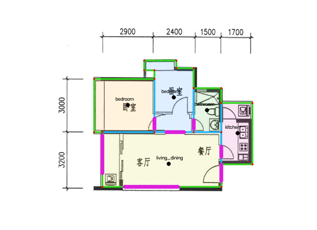

# `fp-001` 人工校正几何 Revision

## 结果

| 项目 | 值 |
|---|---:|
| Layout Revision | `layout_fp001_manual_r2` |
| 节点 | 21 |
| 墙边 | 25 |
| 已确认门窗 | 0 |
| 待复核候选 | 7（5 门、2 窗） |
| 派生房间 | 5 |
| 总室内面积 | 50.04㎡ |
| 墙线覆盖率 | 94.34% |
| 候选最低置信度 | 0.652 |
| 门禁状态 | `needsReview` |

图例：绿色为外墙中心线，橙色为内墙中心线，紫色为算法门窗候选，半透明色块为 Shapely 从墙图派生的 Room Polygon。紫色候选尚未进入 LayoutRevision。

## 房间面积

| 房间 | 类型 | 面积 |
|---|---|---:|
| 左侧卧室 | `bedroom` | 10.27㎡ |
| 中部卧室 | `bedroom` | 8.91㎡ |
| 卫生间 | `bathroom` | 3.88㎡ |
| 厨房 | `kitchen` | 6.12㎡ |
| 客餐厅 | `living_dining` | 20.86㎡ |

## 工件

- [`layout-revision.manual-v2.json`](../../datasets/derived/fp-001/layout-revision.manual-v2.json)
- [`rooms.manual-v2.json`](../../datasets/derived/fp-001/rooms.manual-v2.json)
- [`opening-candidates.auto-v2.json`](../../datasets/derived/fp-001/opening-candidates.auto-v2.json)
- [`quality.manual-v2.json`](../../datasets/derived/fp-001/quality.manual-v2.json)
- [`fp-001-layout-overlay-v2-openings.png`](../../datasets/debug/fp-001-layout-overlay-v2-openings.png)
- 生成脚本：[`build_fp001_manual_revision.py`](../../scripts/build_fp001_manual_revision.py)

## 尚需人工确认

- 5 个门候选的铰链/开启方向与精确洞口起点；当前置信度 0.652～0.988。
- 客厅西/南两个窗候选的精确宽度与窗台高度；当前置信度 0.762～0.772。
- 候选 02/03 的房间两侧采样出现 `bedroom↔bathroom`、`bedroom↔bedroom`，必须由更细的走廊拓扑或人工复核消解。
- 外墙 180mm、内墙 120mm 和层高 2800mm 目前采用 P0 默认值，并非图纸直接标注。

在候选确认前，Revision 2 只包含墙和房间，可用于无开口白模；不得切门窗洞、生成房间热点或评价 AI 门窗保持。

## 审核入口

后端运行于 `127.0.0.1:8000`、前端运行于 `127.0.0.1:5173` 时，打开：

`http://127.0.0.1:5173/?review=fp001`

界面要求 7 项全部确认或驳回后才能提交。提交会生成 `layout-revision.reviewed-v3.json` 和 `opening-review.v3.json`；不会覆盖上述 Revision 2 工件。候选 02/03 不设自动默认答案。

首轮审核确认候选 01/02/04/05/07，驳回 03/06，得到 4 个门和 1 个窗。随后用户红框指出 `w_kitchen_left_upper` 的闭合门扇漏检。Revision 4 的人工写入已废弃为可选兜底；当前 Revision 5 从 Revision 3 出发，由 OpenCV Hough 门弧、最近墙投影、同墙去重和两侧房间采样全自动识别该门，得到 5 个门和 1 个窗。可拖动白模入口为：

`http://127.0.0.1:5173/?model=fp001`

新增工件：

- [`layout-revision.reviewed-v3.json`](../../datasets/derived/fp-001/layout-revision.reviewed-v3.json)
- [`opening-review.v3.json`](../../datasets/derived/fp-001/opening-review.v3.json)
- [`scene-geometry.reviewed-v3.json`](../../datasets/derived/fp-001/scene-geometry.reviewed-v3.json)
- [`layout-revision.reviewed-v4.json`](../../datasets/derived/fp-001/layout-revision.reviewed-v4.json)
- [`manual-correction.v4.json`](../../datasets/derived/fp-001/manual-correction.v4.json)
- [`scene-geometry.reviewed-v4.json`](../../datasets/derived/fp-001/scene-geometry.reviewed-v4.json)
- [`layout-revision.reviewed-v5.json`](../../datasets/derived/fp-001/layout-revision.reviewed-v5.json)
- [`automatic-door-detection.v5.json`](../../datasets/derived/fp-001/automatic-door-detection.v5.json)
- [`scene-geometry.reviewed-v5.json`](../../datasets/derived/fp-001/scene-geometry.reviewed-v5.json)

当前 `scene-geometry.reviewed-v5.json` 包含 36 个墙/窗台/过梁实体，以及从 5 个 Room Polygon 直接生成的 5 张地面和 5 张 2800mm 顶面。Viewer 默认隐藏顶面，可用页面按钮切换。

渲染路径另包含 4 个合并 `wallSlabs`：按 0/600/2100/2200/2800mm 高度分层，对每层墙体 footprint 做 Shapely 并集后挤出。36 个原始实体保留作审计，Viewer 和控制图使用合并墙层以消除墙角穿插面。

同一相机的 RGB、Edge、Normal、Depth、Semantic 控制图已批量捕获到 [`control-maps`](../../datasets/derived/fp-001/control-maps/)；索引记录每张 1024×768 PNG 的 SHA-256，ArtifactManifest 绑定 SceneGeometry 输入哈希。

Revision 5 场景进一步从 5 门/1窗自动生成 25 个 Opening 组件：每门包含左右/顶部门框和一张闭合门扇，每窗包含四边窗框和玻璃。因尚无可靠铰点/mirror，门扇明确保持 `closed`，不推测开启方向。

## 结构全景捕获

- [`camera-plan.auto-v1.json`](../../datasets/derived/fp-001/camera-plan.auto-v1.json)：5个房间的 polylabel 最大净空相机点，高度1500mm。
- [`panorama/living-main/cubemap`](../../datasets/derived/fp-001/panorama/living-main/cubemap/)：客餐厅六个1024²立方体面及索引。
- [`living-main-erp-2048x1024.png`](../../datasets/derived/fp-001/panorama/living-main/living-main-erp-2048x1024.png)：OpenCV 射线映射生成的结构 ERP，经线 seam MAE 0.0488。
- Viewer：`http://127.0.0.1:5173/?manifest=structural`，支持拖拽环视与缩放。

该 ERP 是结构参考图，用于后续 AI 图像编辑和结构 QA，不是最终装修效果图。

## GPT Image 2 Spike v1

- 输入：客餐厅结构 ERP；经 Tuzi `/v1/images/edits` 调用 `gpt-image-2`，密钥仅从本地文件读取。
- 原始输出：[`living-main-gpt-image-2-v1.png`](../../datasets/derived/fp-001/panorama/living-main/ai/living-main-gpt-image-2-v1.png)，1774×887、严格2:1，保留作为原始工件。
- 标准化输出：[`living-main-gpt-image-2-v1-normalized-2048x1024.jpg`](../../datasets/derived/fp-001/panorama/living-main/ai/living-main-gpt-image-2-v1-normalized-2048x1024.jpg)，接缝 MAE 19.929→0。
- 请求/QA记录：[`living-main-gpt-image-2-v1.request.json`](../../datasets/derived/fp-001/panorama/living-main/ai/living-main-gpt-image-2-v1.request.json)，状态 `needsStructureReview`。
- AI Viewer：`http://127.0.0.1:5173/?manifest=ai`。

该样本只证明真实模型调用和装修方向可行，不代表 P0-08 Go：尚缺12样本矩阵、Edge-F1、分区IoU、成本/时延和盲评。

### 6K 清晰度修复

- 模糊根因是模型原始结果只有1774×887，且旧 Viewer 桌面端仍选择2K代理。
- 使用 Real-ESRGAN `realesrgan-x4plus`：环绕填充64px，512px重叠瓦片（最小重叠96px），各瓦片按模型原生4×输出，在4×空间融合后整图缩至3×。
- [`living-main-gpt-image-2-v1-6144x3072.jpg`](../../datasets/derived/fp-001/panorama/living-main/ai/living-main-gpt-image-2-v1-6144x3072.jpg)：6144×3072、约2.61MB、接缝 MAE 0。
- 同时保留4096×2048、2048×1024和1024×512代理；按当前产品决定，GPU/内存能力选图和逐级降级已注释停用，Viewer 固定加载6K原图。
- Canvas 仅保留 `data-panorama-source` 和 `data-panorama-width` 审计；桌面实测客餐厅和厨房均加载6144×3072，控制台无错误。
- 曾测试的NCNN直接3×和无重叠内部分块会产生矩形断层，均已废弃且未保留为发布工件。

## 多房间结构 ERP 与首个结构 QA

- 5个房间均已生成六面 Cubemap 和2048×1024结构 ERP；结构 Viewer 仍使用 `http://127.0.0.1:5173/?manifest=structural`，现可切换5个场景。
- 客餐厅另有独立高精链：[`living-main-erp-4096x2048.png`](../../datasets/derived/fp-001/panorama/living-main/living-main-erp-4096x2048.png)，由6张2048×2048 Cubemap转换，接缝MAE 0.055；原2K工件未被覆盖。
- 2K/4K捕获索引均携带 `CaptureProfile`；当前六面浏览器捕获未执行RenderTarget分配/读回探针，因此对应状态为 `notRun`，未伪报GPU能力。
- 客餐厅额外生成 Semantic ERP：[`semantic-erp-2048x1024.png`](../../datasets/derived/fp-001/panorama/living-main/control/semantic/semantic-erp-2048x1024.png)。
- QA 报告：[`living-main-gpt-image-2-v1.structure-qa.json`](../../datasets/derived/fp-001/panorama/living-main/ai/living-main-gpt-image-2-v1.structure-qa.json)。
- 边界 Overlay：[`living-main-gpt-image-2-v1.structure-edge-overlay.jpg`](../../datasets/derived/fp-001/panorama/living-main/ai/living-main-gpt-image-2-v1.structure-edge-overlay.jpg)。
- 全结构6px召回代理0.392、门窗0.385；这不是 Edge-F1。`regionIoU` 和 `edgeF1` 保持 null，直到接入 AI 室内语义分割。
- 厨房结构 ERP 先行就绪；密钥恢复后已继续完成下述厨房真实生成任务。

## GPT Image 2 厨房样本 v1

- 密钥恢复后已完成厨房真实图生图，原始输出：[`kitchen-main-gpt-image-2-v1.png`](../../datasets/derived/fp-001/panorama/kitchen-main/ai/kitchen-main-gpt-image-2-v1.png)，1774×887、严格2:1。
- 6K结果：[`kitchen-main-gpt-image-2-v1-6144x3072.jpg`](../../datasets/derived/fp-001/panorama/kitchen-main/ai/kitchen-main-gpt-image-2-v1-6144x3072.jpg)，接缝 MAE 0，并生成4K/2K/1K代理。
- QA：[`kitchen-main-gpt-image-2-v1.structure-qa.json`](../../datasets/derived/fp-001/panorama/kitchen-main/ai/kitchen-main-gpt-image-2-v1.structure-qa.json)，状态 `needsReview`。
- Overlay：[`kitchen-main-gpt-image-2-v1.structure-edge-overlay.jpg`](../../datasets/derived/fp-001/panorama/kitchen-main/ai/kitchen-main-gpt-image-2-v1.structure-edge-overlay.jpg)。
- AI Viewer `http://127.0.0.1:5173/?manifest=ai` 现可切换客餐厅和厨房两个6K场景。

厨房代理结构召回仍未达门槛，故第二样本依然属于 Spike 工件，不进入正式发布。

## StyleCatalog 与奶油风第3样本

- [`style-catalog.v1.json`](../../datasets/derived/fp-001/style-catalog.v1.json) 包含现代、中式、北欧、奶油、法式、混搭、轻奢、侘寂8种设计风格；设计风格与写实媒介、灵感、色板、材质分字段保存。
- 该字段分层参考 `3vj-js` Bundle 与公开 `aidrawcfg20250427.json` 的行为；PromptSuffix、色板和材质由本项目独立定义。
- 奶油风6K：[`living-main-gpt-image-2-cream-v1-6144x3072.jpg`](../../datasets/derived/fp-001/panorama/living-main/ai/living-main-gpt-image-2-cream-v1-6144x3072.jpg)。
- 奶油风QA：[`living-main-gpt-image-2-cream-v1.structure-qa.json`](../../datasets/derived/fp-001/panorama/living-main/ai/living-main-gpt-image-2-cream-v1.structure-qa.json)。
- QA代理：全结构6px召回0.475、门窗0.564，仍为 `needsReview`。
- AI Viewer 现有3场景：默认客餐厅、厨房、客餐厅奶油风。

## 算法依据

品爱资料中的《户型图CAD上传至3D自由浏览全链路技术方案》和现有 Bundle 给出了三维家 CAD 路径的门窗规则：门图层 INSERT/ARC、墙矩形 80～450mm 短边、反向法线对边距离至少 500mm、投影重叠至少 50mm；窗线在 350mm 范围聚类。当前 JPG/PNG 实现将这些物理规则映射为“墙带缺口 + 四分之一门弧 + 长窗缺口”，并增加 WallEdge 投影和 Room Polygon 两侧采样。
