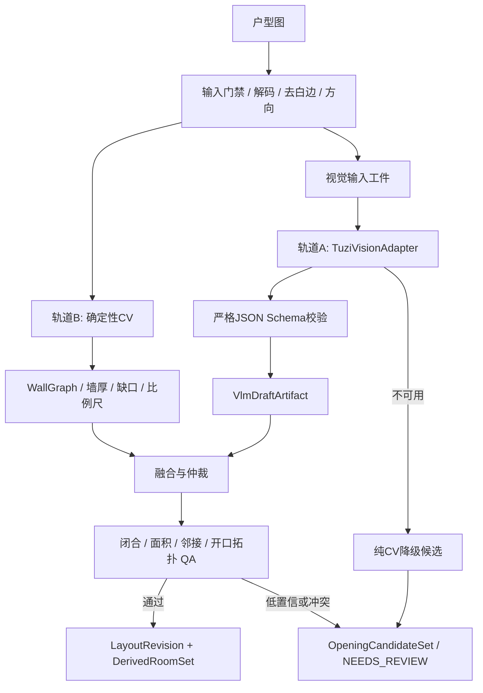

# 户型图识别技术方案 v2：CV + Tuzi 视觉模型 + 几何融合

> 状态：**实施基线 1.0**（2026-08-28）
> 适用输入：清晰、单层、以正交墙为主的 JPG/PNG/WebP 户型图
> 详细任务：[floorplan-recognition-v2-todo.md](./floorplan-recognition-v2-todo.md)
> 纯 CV 降级基线：[floorplan-recognition-v1.md](./floorplan-recognition-v1.md)

## 0. 结论与不可破坏边界

方案可行，但必须遵守以下边界：

1. **Tuzi 是视觉 Provider，不是几何真值源。**视觉模型只输出 `VlmDraft`；墙、房间、门窗必须经过 Schema、几何吸附、比例尺/面积自洽和拓扑门禁才能进入事实工件。
2. **不写死 Gemini 或任何未经当前 Key 验证的模型名。**启动时从 Tuzi `/v1/models` 获取候选模型，并对图片输入、严格 JSON Schema、最大输出长度做能力探针。
3. **使用 Tuzi OpenAI 兼容接口（图片理解 + 结构化输出）。** 当前生产适配仍走 `POST /v1/chat/completions`，响应必须经过本地严格Schema校验。
   - **最新实测（2026-09-04）**：`/v1/responses` 纯文本可用，但内嵌图片在代理和直连下均于响应头前断开；`/v1/chat/completions` 图片能到达模型，但严格Schema并非每次都返回合法JSON。
   - 因此暂不切换endpoint，也不解析自由文本猜JSON；失败统一归一为视觉不可用并让CV链自动继续。给模型的schema仍使用展平的OpenAPI子集，见 `vision/contracts.vlm_draft_openai_schema`。
4. **低置信结果不进入 `LayoutRevision`。**只进入 `OpeningCandidateSet`、`VlmDraftArtifact` 或项目 `NEEDS_REVIEW`。
5. **Provider 不可用时仍可交付确定性降级。**纯 CV 输出可审计候选；不得发布自由文本、半截 JSON 或旧缓存冒充当前结果。
6. **Tuzi 中转不消除第三方数据风险。**户型图会发送到 Tuzi 及其上游模型；必须执行服务端密钥、短时输入、日志脱敏、保留/删除策略和用户授权边界。

当前已确认的 Tuzi 能力边界：

- `POST /v1/responses` 的纯文本请求可用，文档声明支持 `input_text + input_image`；当前网络路径尚未完成图片请求；
- Responses结构化输出文档格式为 `text.format={type:"json_schema", name, strict, schema}`；
- Chat图片请求可达上游，但结构化结果必须按不稳定外部能力处理；
- 模型可通过 `/v1/models` 查询，但**实际可用模型依赖当前 API Key**。

官方接口依据：[Tuzi Responses 图片](https://tuzi-api.apifox.cn/463707786e0)、[Tuzi 模型列表](https://tuzi-api.apifox.cn/343647074e0)。

## 1. 目标与验收门槛

| 指标 | P0 门槛 | 说明 |
|---|---:|---|
| Room mIoU | ≥ 0.90 | 匈牙利匹配后的房间多边形 IoU |
| 房间数完全正确率 | ≥ 90% | 按标注规范 R-01 计算 |
| 邻接边 F1 | ≥ 0.95 | 房间邻接图的边 F1 |
| 门窗 F1 | ≥ 0.90 | door/window 分类别统计 |
| 比例尺相对误差 | P90 ≤ 5% | OCR尺寸与几何约束联合校准 |
| 墙中心线误差 | 中位 ≤ 0.5×墙厚 | 预测轴线到真值轴线距离 |
| VLM JSON 有效率 | 100% 进入融合层 | 无效输出只能修复重试或复核 |
| 错误几何发布率 | 0 | 未过门结果不得成为当前 Revision |

测试集不得参与 Prompt、模型、阈值或融合容差选择。真值格式沿用 [annotation-spec-v1.md](./annotation-spec-v1.md)。

## 2. 总体架构



### 2.1 轨道职责

| 能力 | CV轨道 | Tuzi视觉轨道 |
|---|---|---|
| 墙体 | 精确轴线、墙厚、缺口区间 | 只提供粗墙/房间结构提示 |
| 房间 | 正交化、闭合、面积积分、邻接 | 房间类型、名称、粗多边形、OCR面积 |
| 门窗 | 墙带缺口、WallEdge投影、两侧房间 | 门/窗/垭口语义、门弧/门扇/平行线证据 |
| 比例尺 | 墙厚自举、多约束拟合 | 读取尺寸文字并给出对应两点 |
| 置信度 | 几何残差、拓扑一致性 | 仅作辅助，自陈置信必须校准 |

### 2.2 为什么不能纯视觉模型直出

- 坐标可能漂移、重复、越界或未闭合；
- 房间面积和尺寸文字可能被幻觉；
- Provider可能更新上游模型但仍沿用同一别名；
- 中转站可能不完全支持某模型的严格JSON能力；
- 识别一张图成功不能证明跨户型稳定。

所以视觉输出只能作为候选工件，最终几何仍由本地可验证算法决定。

## 3. Tuzi Provider 设计

### 3.1 配置

```text
TUZI_BASE_URL=https://api.tu-zi.com
TUZI_API_KEY=<process-environment-or-secret-injection>
TUZI_VISION_PRIMARY_MODEL=<runtime-verified-model-id>
TUZI_VISION_REVIEW_MODEL=<runtime-verified-model-id>
TUZI_TIMEOUT_SECONDS=180
TUZI_MAX_IMAGE_BYTES=10485760
```

- Key通过进程环境变量或部署Secret注入；不写入仓库、浏览器、Prompt记录或错误响应。本地开发使用Windows用户级 `TUZI_API_KEY`。
- 模型ID是部署配置，不是代码常量。
- 未设置模型ID时，服务启动失败；不得自动挑“列表第一个模型”。

### 3.2 启动能力探针

启动或模型配置变化时，对每个模型执行一次小图探针：

1. `/v1/models` 中存在该模型；
2. `/v1/chat/completions` 接受 `image_url`（或 Data URI）图片输入；
3. 接受严格 `json_schema`（`response_format.type=json_schema`，展平 OpenAPI 子集）；
4. 返回可解析JSON且字段服从Schema；
5. 返回或响应头中可取得请求ID；
6. 记录实际模型ID、延迟、usage结构和最大输出限制。

探针结果写入 `VisionCapabilityProfile`。失败时服务可启动，但视觉轨道状态为 `UNAVAILABLE`，项目自动走纯CV复核路径。

### 3.3 请求格式

```json
{
  "model": "<TUZI_VISION_PRIMARY_MODEL>",
  "messages": [
    {
      "role": "user",
      "content": [
        {"type": "text", "text": "<versioned prompt, 写明坐标归一化>"},
        {"type": "image_url", "image_url": {"url": "<data-uri>"}}
      ]
    }
  ],
  "response_format": {
    "type": "json_schema",
    "json_schema": {"name": "floorplan_draft_v1", "strict": true, "schema": {"<flattened OpenAPI schema>"}}
  },
  "max_tokens": 16384
}
```

图片传输策略：

- 使用内存构造的 Data URI（实测本网关接受 `image_url.data:image/png;base64,...`）；
- URL、Base64、原图和签名参数均不得进入普通日志；
- 输入图片先清除EXIF，限制MIME、像素、字节和解压后尺寸。

### 3.4 Adapter接口

```python
class VisionProvider(Protocol):
    def capabilities(self) -> VisionCapabilityProfile: ...
    def parse(self, request: VisionParseRequest) -> VisionRunResult: ...
    def review(self, request: VisionReviewRequest) -> VisionRunResult: ...

class TuziResponsesVisionProvider:
    """OpenAI Responses-compatible Tuzi adapter; no geometry publication."""
```

业务层只依赖 `VisionProvider`，不感知Tuzi、Gemini、GPT或其他模型的私有字段。

### 3.5 重试和错误归一

| 情况 | 行为 |
|---|---|
| 连接失败、429、502/503/504 | 指数退避，最多2次；尊重Retry-After |
| 其他5xx | 最多1次；仍失败转纯CV复核 |
| 400/401/403 | 不重试，标配置或输入错误 |
| 内容审核 | 不重试，记录公开错误码，结果进入复核 |
| JSON截断/Schema无效 | 同模型纠错提示最多1次；仍失败转复核 |
| 模型不存在/不支持图片/JSON Schema | 禁用该模型配置，等待运维修复 |

统一错误码：

```text
VISION_PROVIDER_UNAVAILABLE
VISION_MODEL_NOT_AVAILABLE
VISION_INPUT_UNSUPPORTED
VISION_STRUCTURED_OUTPUT_UNSUPPORTED
VISION_SCHEMA_INVALID
VISION_OUTPUT_TRUNCATED
VISION_CONTENT_FILTERED
VISION_RATE_LIMITED
VISION_TIMEOUT
VISION_UPSTREAM_ERROR
```

## 4. 视觉输出契约

坐标相对原始输入图归一化到 `[0,1]`，原点左上、y向下。

```json
{
  "scaleCandidates": [
    {
      "lengthMm": 3600,
      "pixelStart": [0.30, 0.88],
      "pixelEnd": [0.70, 0.88],
      "text": "3600",
      "confidence": 0.94
    }
  ],
  "rooms": [
    {
      "type": "bedroom",
      "name": "卧室",
      "areaLabelM2": 12.8,
      "polygon": [[0.12, 0.10], [0.30, 0.10], [0.30, 0.40], [0.12, 0.40]],
      "confidence": 0.90
    }
  ],
  "openings": [
    {
      "type": "door",
      "evidence": ["doorArc", "doorLeaf"],
      "pixelStart": [0.30, 0.25],
      "pixelEnd": [0.30, 0.35],
      "confidence": 0.88
    }
  ],
  "warnings": []
}
```

Schema必须限制：

- 房间最多64个、开口最多256个、比例候选最多32个；
- 坐标必须在 `[0,1]`；
- 房间多边形3–64点；
- 枚举外类型拒绝；
- 不接受额外字段；
- `confidence`只记录，不直接决定发布。

Provider原始响应单独保存为受限调试工件；业务使用的 `VlmDraftArtifact` 必须是Schema验证后的规范化JSON。

## 5. 融合与几何仲裁

### 5.1 F1 坐标解归一与吸附

- `(nx, ny) → (nx×width, ny×height)`；
- 顶点吸附到最近CV墙轴，最大距离为动态墙厚倍数；
- 开口端点先投影到最近WallEdge，再沿墙保存 `offset/width`；
- 无匹配墙或投影距离超限的结果只进候选集。

### 5.2 F2 比例尺与面积自洽

- 对每条OCR尺寸计算 `mmPerPixel = lengthMm / pixelDistance`；
- 用中位数/MAD剔除离群值，再与CV墙厚自举交叉验证；
- 最大残差超过冻结阈值时不得确认比例尺；
- 房间多边形积分面积与图面面积标签相差超过15%时降级复核。

### 5.3 F3 开口仲裁

通过条件必须同时满足：

1. VLM类型和证据合法；
2. 端点可投影到同一WallEdge；
3. CV墙带存在对应缺口或强门弧/窗线证据；
4. 宽度在物理Profile内；
5. 两侧房间/内外拓扑成立；
6. 不与已确认开口重叠。

不一致时保存双方证据和Reason Code，不做静默覆盖。

### 5.4 F4 房间闭合

- VLM粗多边形只提供区域种子和语义；
- 边界沿CV WallGraph收边并正交化；
- 去自交、悬空边、重复点和零面积环；
- 多边形必须闭合且面积、房间数、邻接满足质量门；
- 完全没有WallGraph时可以显示VLM草稿，但状态必须为 `NEEDS_REVIEW`，不得生成最终3D。

## 6. 工件、缓存与幂等

新增工件：

```text
VisionInputArtifact
VisionCapabilityProfile
VisionRunEvidence
VlmDraftArtifact
FusionEvidence
FloorplanQualityReport
```

视觉任务键：

```text
SHA256(
  imageSha256 + provider + baseUrlProfile + requestedModel +
  promptVersion + draftSchemaVersion + preprocessingVersion
)
```

`VisionRunEvidence` 至少记录：

```text
provider=tuzi
endpoint=/v1/responses
requestedModel
actualModel
providerRequestId
promptVersion
draftSchemaVersion
imageSha256
latencyMs
usage
attemptCount
rawResponseSha256
normalizedDraftSha256
status/errorCode
```

缓存只复用完全相同的任务键；模型、Prompt、Schema或预处理变化必须生成新任务。旧LayoutRevision的视觉结果不得写入新Revision。

## 7. 安全与隐私

1. 视觉请求只从服务端发出；浏览器永远看不到Tuzi Key。
2. API Key由Secret Manager或只读挂载文件提供；启动时校验，日志永不输出。
3. 图片发送Tuzi前清EXIF、校验Magic Bytes、限制像素/字节、拒绝外部URL输入。
4. 日志只记录Hash、尺寸、模型、请求ID、耗时、用量和错误码。
5. 原始响应默认短期保留并加密；普通成功任务只保留规范化Draft和Hash。
6. 分享项目删除时同步删除视觉输入、原始响应、Draft和缓存。
7. 产品隐私说明必须披露户型图会被第三方视觉服务处理；未获授权不得调用。

## 8. 可观测性与成本门

按模型和来源记录：

- 调用量、成功率、Schema有效率；
- P50/P95延迟、429/5xx/超时；
- 输入/输出用量和单图成本；
- 重试率、复核率、缓存命中率；
- Room mIoU、邻接F1、门窗F1；
- 模型版本变化前后的质量漂移。

入队前检查租户预算、项目预算、单图最大调用次数和日限额。达到上限直接走纯CV复核，不无限重试。

## 9. 发布与回退策略

```text
OFF       仅CV，VLM不调用
SHADOW    调VLM并评测，但不影响用户结果
ASSISTED  VLM参与候选与复核，最终仍过几何门
ON        通过留出集门禁后作为P0主路径
```

初始必须为 `SHADOW`。只有同一冻结测试集满足全部P0指标，并完成隐私/成本评审后才能进入 `ASSISTED`；`ON`需要独立发布评审。

回退触发：Tuzi能力探针失败、模型消失/变化、Schema有效率或质量越线、预算耗尽、隐私风险事件。回退结果是 `CV + NEEDS_REVIEW`，不是无结果，也不是过期视觉草稿。

## 10. 当前状态

- 上传、CV识别、Tuzi视觉尝试、几何建模、全房间生图、本地超分、可拖动全景和24小时临时分享已串成一条自动链；视觉失败只产生告警并自动走结构全景，不要求人工放行；
- CV预处理、WallGraph、RoomPolygon、门窗候选和证据工件位于 `backend/pano_platform/floorplan/`；Tuzi识别Adapter和图片生成Adapter均已实现；
- ResPlan官方test split前30图已成为公共结构回归源：259个真值房间、当前258个预测房间，30/30自动生成Viewer；当前严格确认121个门和95个窗。该计数仍包含逐图过分割、欠分割和开口漏检，不代表IoU/F1或逐图全对；桌面9图当前50个房间、25个门、3个窗，9/9自动生成Viewer；
- ResPlan派生栅格使用 `v3-window-parallel-lines`：窗由真值长轴绘制为两条平行窗扇线，保证测试图与 `parallelLines` 真值声明及生产窗证据门一致；
- 已定位的虚拟缺口从原始二值墨迹读取双平行窗线，避免连在墙端的窗线被墙体重建吞掉；确认仍必须同时满足物理宽度和仅一侧有房间，不在全图直接发布双线候选；
- 对未形成虚拟缺口的窗，沿已有实墙/边界WallEdge局部扫描“单块实墙截面变为两条分离细线”的连续区间；结果必须满足物理宽度、单侧房间、门弧互斥，并与其他平行窗区间跨WallEdge去重。该路径只生成开口，不重写墙图或房间。
- 窗的两侧房间采样使用3倍墙厚，以跨过墙带膨胀区；门保持1.5倍。300mm窗宽下限不因比例尺自举而降低，避免页面尺寸线进入外窗结果。
- ResPlan回归报告按房间、门、窗分别输出逐图真值/预测/差值，并提供总计；计数只用于防退化和定位，不替代IoU、匹配精度或正式F1。
- 小型房间若面积不超过5㎡且至少48%周长依赖没有真实墙墨迹的矩形补边，会在开口拓扑仲裁后从交付房间集中移除并写入自动证据；大型兜底外壳保留，避免复杂真实图因保守过滤失去主体预览。
- 0.05～0.1㎡区域继续参与门窗拓扑，仲裁完成后才从交付房间集中移除并单独留证；不得继续提高面积下限来追求房间总数，因为早期移除已验证会降低门召回。
- 面积不超过3㎡且整圈至少58%边界没有真实墙Mask支撑的空间，也只在门窗仲裁后移除并留证；该规则不处理大型兜底外壳，避免以过滤代替缺失房间恢复。
- 房间Barrier的形态学闭合半径为0.9倍实测墙宽，用于封闭墙角/扫描微缝；0.75倍已验证漏房，1.0倍以上会明显重排桌面房间，因此不用于当前生产基线。
- 项目运行依赖以 `pyproject.toml` 为唯一声明源；本地验证使用项目`.venv`安装 `.[dev]`。上传表单所需`python-multipart`和Tuzi HTTP链所需`requests`均为固定运行依赖，不能依赖系统Python偶然预装。
- 本机开发可在Git忽略的项目根`.env`配置Tuzi，`.env.example`只保存变量名和非敏感默认值；`python-dotenv`在包加载和独立生图脚本中读取它，显式进程环境变量优先。生产部署仍应使用Secret注入而不是复制`.env`。
- 当前实测视觉组合为主模型`gemini-3.7-flash`、复核模型`gemini-3.5-flash-lite`；模型列表存在不代表图片＋严格JSON可用，必须以同一能力探针结果为准。`resplan-00008`已从CV 4房提升到VLM融合6房并通过QA及完整Viewer链，仍低于8房真值。
- 主模型完成自身有界重试后仍失败时，解析链自动尝试配置的复核模型；内容安全拦截不跨模型重试。视觉缓存键同时包含两个模型，避免模型组合变化后复用旧草案。
- 共线空白只在300～2500mm内生成结构虚拟墙；该上限由ResPlan与桌面9图四档联合回归确定，避免把约2.5～3m开放区域错误切成房间；
- CV门弧仍执行500～1500mm物理门宽、WallEdge、弧分数和房间拓扑门禁；由于CV比例尺仅由110mm墙厚自举，强门弧允许 `0.7×物理下限-1像素` 的量化容差，并以 `CV_ARC_BOOTSTRAP_SCALE_TOLERANCE` 单独留证；
- 对包含多个内部房间的疑似包围壳不直接删除：保留其拓扑证据，写入 `automatic-room-evidence.json` 并将对应全景排到末位，防止误当默认客户场景；
- Tuzi模型和Key均由服务端环境变量读取；当前Chat图片结构化输出与Responses图片链仍不稳定，所以本地严格校验和CV自动回退是必须保留的运行路径；
- `floorplan-to-3d`、FloorplanVLM、MiniCPM LoRA、Raster-to-Graph均未进入生产依赖；ResPlan按固定提交和许可证登记，仅用于回归；
- 程序化家具、正式云部署、安全成本门、正式F1和大样本发布门按当前优先级后置，不阻断功能主链。

下一步严格按照 [详细TODO](./floorplan-recognition-v2-todo.md) 执行。
