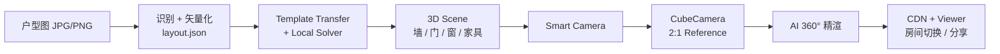
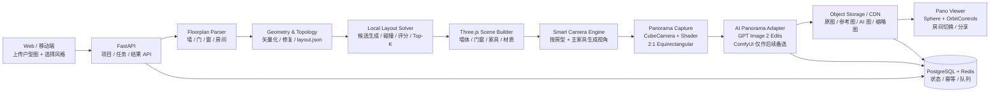
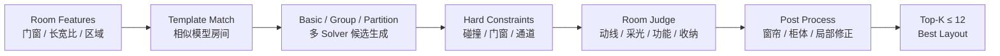
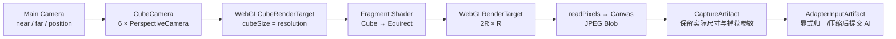
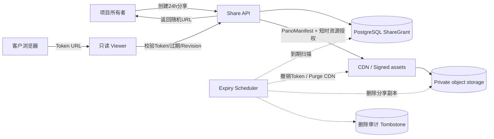

# 户型图 → AI 360° 全景自主实现技术方案

> v3.1｜基于标准规范与全链路工程实现设计，补全：applyRoom 布局分发与 Judge 规则体系、ViewCamera 各房型精确规则与全景调参规范、结构全景 Shader/CPU Cubemap 投影数学与多端设备分支、AI 渲染任务语义与风格模式枚举、分享 URL 规范与全景场景数据结构。接口与算法均采用自研实现。

> **2026-08-24 评审补充：**P0 的核心应从“模块全部自研、预留多种实现”收敛为“一条自托管、可复现、可恢复、可验证的垂直链路”。AI 只作为通过质量门后的增强结果，确定性基础材质全景必须始终可交付。具体改进与执行项见第 23 节。

> **目标成品补充：**最终 Viewer 和多视角交付以用户指定的 3VJIA 分享页为黑盒验收基线；P0 AI 主路径改为服务端调用 `gpt-image-2` Image Edits。由于该模型最长边限制为 3840px，6K 成品采用 `3840×1920` 生成、环绕 QA、再超分至 `6144×3072`，不把 6K 直出写成假设。

> Markdown 版：架构图采用 Mermaid，可直接放入 GitHub / GitLab / Obsidian / Typora 等支持 Mermaid 的环境。

| **方案定位：**目标是自主实现“上传户型图 → 自动布局 → 3D 结构场景 → 2:1 结构全景 → AI 精渲 → 360° 网页漫游与分享”的最短闭环。 |
|--------------------------------------------------------------------------------------------------------------------------------|

2026-08-21

# 目录
0. 文档结论与边界

1. 产品目标与用户流程

2. 核心架构设计与技术选型

3. 总体系统架构

4. 核心数据模型与坐标约定

5. 户型图识别与矢量化

6. 几何拓扑修复与质量门禁

7. 家具资产库与模板元数据

8. 本地家具布局求解器

9. Three.js 3D 场景构建

10. 智能相机 / ViewCamera 引擎

11. 360° 结构全景捕获引擎

12. AI 360° 精渲 Pipeline

13. 全景后处理与接缝控制

14. 全景 Viewer 与房间切换

15. 后端 API 与任务状态机

16. 幂等、缓存、重试与并发

17. 数据库与对象存储结构

18. 部署拓扑与资源建议

19. 可观测性与调试产物

20. 验收指标与自动化测试

21. 实施计划与里程碑

22. 风险、降级与 P1/P2 扩展

23. 精进结论与执行 TODO

附录 A. layout.json 示例

附录 B. pano.json 示例

附录 C. 推荐仓库目录结构

# 0. 文档结论与边界
本方案旨在构建一套完全自主可控的工程闭环系统。系统不依赖任何外部私有 API、私有文件格式或第三方渲染黑盒，完全基于开源标准与自研管线构建。P0 阶段目标是建立稳定可上线的闭环：标准户型图上传后，能够自动生成每个主要房间的 AI 360° 全景并通过链接查看。

| **项** | **P0 范围** | **暂不做** |
|---|---|---|
| 输入 | JPG/PNG/WebP 单层户型图；干净、规则、可识别比例 | DWG/DXF、复杂多楼层、手绘草图 |
| 房间 | 客餐厅、卧室、厨房、卫生间、阳台 | 异形复式、超大商业空间 |
| 布局 | 规则 + 几何求解 + Top-K 评分 | 完整专业设计师级方案、自由拖拽编辑器 |
| 3D | 结构白模 + 基础家具/材质，用于 AI 约束 | 高精 PBR 实时编辑器、云设计器 |
| 全景 | 每房支持 1～N 个视角；P0 验收样例为 2 个房间、8 个可切换视角 | 连续自由走动的完整 3D 世界 |
| AI | 结构受控的 panorama img2img / 风格增强 | 复杂多智能体联合推演 |
| Viewer | 360°拖拽、FOV 缩放、房间切换、热点、分享 | 复杂营销/会员/计费系统 |

| **实现建议：**核心原则是“结构确定性优先，AI 负责美化”。任何一步识别或拓扑无法确认时，必须自动降级为可浏览的低置信度结构预览并记录证据；人工校正只能作为可选增强，不能成为出图前置条件。 |
|---|

# 1. 产品目标与用户流程
用户侧交互流程：上传户型图，选择目标装修风格，系统自动推演布局并生成全景，最终通过只读链接进行 360° 空间漫游。



## 1.1 用户侧最短路径
1. 上传 JPG/PNG 户型图，系统自动校验图像分辨率、比例尺及封闭房间完整性。
2. 自动识别房间轮廓、墙体、门窗并输出标准 `layout.json`，必要时生成调试叠加层（Debug Overlay）供确认。
3. 选择预设风格（现代、奶油、新中式、北欧、轻奢等）。
4. 布局引擎自动分配基础家具，计算房间最优视角并生成结构全景参考图。
5. AI 精渲管线保持空间透视与几何约束，对材质、光影及软装进行高保真渲染。
6. 输出只读全景链接，支持多端拖拽浏览、房间热点切换及一键分享。

# 2. 核心架构设计与技术选型
| **模块** | **功能定义** | **自主实现方案** |
|---|---|---|
| 智能视角 | 根据房型及焦点家具计算最佳构图视点与全景机位。 | 自研 CameraRuleEngine，基于边界法与射线迭代进行机位收敛。 |
| 自动布局 | 基于空间几何与拓扑关系分配家具并完成合理性打分。 | 采用“模板迁移优先 + 程序化兜底 + 硬约束淘汰 + 房型专用 Judge + Top-K 优选”。 |
| 结构全景 | 从 3D 场景捕获 360° 空间结构并投影为等距柱状全景图。 | 基于 Three.js CubeCamera + 自定义 Cubemap-to-Equirectangular 着色器，支持六面 Cubemap CPU 转换降级。 |
| 分辨率与投影 | 全景捕获尺寸与长宽比控制。 | 严格保持 2:1 Equirectangular 投影，基准尺寸 R=1024（2048×1024）或 R=2048（4096×2048）。 |
| 裁剪面管理 | 消除近景穿模与远景丢失。 | 统一由 CameraProfile 管理 Near/Far 裁剪面。 |
| AI 渲染接口 | 控制结构保持与风格迁移的数据交互。 | 自定义统一的 AIRequest Schema，解耦底层模型与任务调度。 |
| 全景 Viewer | 轻量级网页端 360° 全景漫游与交互。 | 基于 React + Three.js（SphereGeometry + OrbitControls）轻量实现。 |

# 3. 总体系统架构


## 3.1 服务拆分
| **模块** | **职责** | **技术实现** |
|---|---|---|
| Web 前端 | 交互操作、状态轮询、轻量校正、Viewer 呈现 | React / Vue 3 + TypeScript |
| API 网关 | 项目流转、任务调度、回调管理、分享鉴权 | FastAPI |
| 户型解析器 | 图像预处理、WallGraph、OCR/房间/开口候选、几何融合 | Python + OpenCV/Shapely 确定性几何；纯CV可独立降级 |
| 视觉识别 Adapter | 经 Tuzi 提交户型图，获取严格Schema约束的语义与粗结构Draft | Tuzi OpenAI兼容 `/v1/responses`；运行时模型发现与能力探针；仅服务端持有Key |
| 几何引擎 | 多边形正交化、线段吸附、门窗投影、拓扑校验 | Shapely / NumPy |
| 布局求解器 | 空间特征提取、模板迁移、碰撞检测、Judge 综合打分 | Python 几何算法引擎 + 规则系统 |
| 场景构建器 | 将矢量数据与家具清单组装为可渲染 3D 场景 | Three.js（支持 Headless / 浏览器双端） |
| 全景捕获器 | 3D 场景多视角捕获与等距柱状全景投影生成 | WebGL2 Shader / Cubemap CPU Fallback |
| AI 渲染 Adapter | 将结构 ERP 和有限参考图提交给 GPT Image 2，并完成错误归一、QA 与工件登记 | OpenAI Image API 异步 Adapter；API Key 仅在服务端 |
| 任务队列与存储 | 异步任务分发、元数据持久化、静态资源托管 | Redis + RQ/Celery + PostgreSQL + S3/MinIO/OSS |

# 4. 核心数据模型与坐标约定
## 4.1 核心数据模型（Canonical Layout Model）
以 `layout.json` 作为系统唯一的几何事实源，所有下游模块（3D 场景、智能相机、Debug 视图）均基于此模型派生。

| **对象** | **核心字段** | **说明** |
|---|---|---|
| Wall | `id, start, end, thickness, height` | 2D 墙中线 + 厚度；层高默认 2800mm |
| Door | `id, wallId, center, width, height, rotation, fromRoom, toRoom` | 门洞投影于指定 Wall；高度默认 2200mm |
| Window | `id, wallId, center, width, sill, height, rotation` | 窗台高默认 600mm，窗高默认 1500mm |
| Room | `id, name, type, polygon, area, adjacency` | 封闭多边形轮廓及拓扑邻接关系 |
| Furniture | `id, category, assetId, roomId, position, size, rotation, clearance` | 空间摆放结果与通行包络 |
| Camera | `id, roomId, name, position, quaternion, fov, near, far` | 视点位置与初始观察方向 |
| Panorama | `id, cameraId, referenceUrl, resultUrl, width, height, projection, status` | 结构参考图与渲染结果元数据 |

## 4.2 坐标系与单位
- **业务/几何层**：统一采用右手坐标系，地面为 XY 平面，+Z 为高度方向，单位统一为毫米（mm）。
- **Three.js 渲染层**：统一进行毫米到米（÷ 1000）的单位换算，保证深度缓冲精度。
- **角度表达**：所有旋转统一记录偏航角（Yaw，度/弧度）与四元数（Quaternion），并在字段明确标注单位。

# 5. 户型图识别与矢量化
## 5.1 输入质量门禁
- **可读性**：不再用短边1200px一刀切；结合墙笔画半径、墨迹占比、Manhattan置信度、OCR尺寸一致性判断。低清图不能靠简单放大绕过门禁。
- **倾角校正**：支持 ±5° 内自动纠偏，超过阈值需引导用户重新上传。
- **比例尺校验**：Tuzi视觉模型读取尺寸文字和对应两点，CV执行多约束鲁棒拟合并与墙厚自举交叉校验；缺失或冲突时标记 `scaleBootstrap/needsReview`。
- **房间闭合度**：融合后至少包含一个有效封闭房间；否则输出证据并进入 `NEEDS_REVIEW`，不得继续生成最终3D。

## 5.2 解析流水线
```text
输入图像 -> 输入门禁/预处理
  ├─ CV轨道：笔画分析 -> WallGraph/墙厚/缺口/比例尺基线
  └─ Tuzi视觉轨道：/v1/responses + input_image + strict json_schema -> VlmDraft
-> Schema校验 -> 坐标解归一 -> 吸附WallGraph -> 比例尺/面积自洽
-> 门窗投影与两侧房间拓扑 -> 房间闭合/邻接QA
-> 通过：LayoutRevision/DerivedRoomSet；冲突：OpeningCandidateSet/NEEDS_REVIEW
```

完整识别方案与Provider边界见 [`floorplan-recognition-v2.md`](./docs/plan/floorplan-recognition-v2.md)，详细执行任务见 [`floorplan-recognition-v2-todo.md`](./docs/plan/floorplan-recognition-v2-todo.md)。

## 5.3 门窗候选检测与确认

门窗不允许由人工“目测写死”，也不允许低置信候选直接进入 `LayoutRevision`。解析器先生成独立 `OpeningCandidateSet`，复核或高置信规则通过后才转为 Door/Window 几何事实。

| 输入/阶段 | 门候选 | 窗候选 |
|---|---|---|
| CAD/DXF | 优先读取门图层的 INSERT/ARC；墙矩形短边 80～450mm，查找反向法线对边；对边距离至少 500mm、投影重叠至少 50mm 才形成门洞矩形；门扇圆弧确定铰链和开启方向。 | 普通窗图层的 LINE/LWPOLYLINE/INSERT；350mm 范围内聚类平行细线，生成宽 > 深的包围盒。 |
| JPG/PNG | 在已校准墙带上寻找 450～1500mm 低强度缺口；缺口端点搜索四分之一圆弧和门扇径向线，组合为门候选。 | 外墙长缺口或墙带内多条同向细线组；按 350mm 物理范围聚类并合并共线区间。 |
| 墙投影 | 候选区间必须完整落在单一 WallEdge，保存沿墙 `offset/width`，不得跨墙角。 | 同左；多个相邻共线候选合并，过短/过深候选淘汰。 |
| 拓扑验证 | 门洞中点沿墙法向两侧采样 Room Polygon；两侧相同房间或异常组合自动拒绝该候选并继续生成无该开口的预览，外门允许一侧为 outside。 | 窗通常要求一侧为房间、一侧为 outside；内窗必须显式声明；不以人工确认阻断全链路。 |

候选状态流：`DETECTED → NEEDS_REVIEW → CONFIRMED / REJECTED`。只有 `CONFIRMED` 才能切 3D 洞口、生成房间邻接或进入布局避让。

# 6. 几何拓扑修复与质量门禁
| **规则项** | **处理逻辑** |
|---|---|
| 线段吸附 | 端点欧氏距离 < 20~40mm 自动吸附，夹角接近 0°/90° 自动正交化。 |
| 墙体缝隙 | 微小缝隙执行射线延长求交闭合；明显断裂自动使用外轮廓/结构预览兜底并记录待复核证据。 |
| 门窗归属 | 候选区间必须完整落在对应 WallEdge；沿墙保存 offset/width，两侧采样决定邻接。低置信或拓扑冲突候选不写入 LayoutRevision。 |
| 房间有效性 | 验证多边形面积阈值，剔除自相交、共线退化点及无效开口。 |
| 空间拓扑 | 根据门洞双侧采样生成 Room Adjacency Graph（房间连通图）。 |

# 7. 家具资产库与模板元数据
采用标准 GLTF/GLB 格式构建基础模型资产库，侧重包络尺寸、锚定规则与通道语义定义。

| **字段** | **示例** | **语义定义** |
|---|---|---|
| category | `sofa` / `bed` / `dining_table` | 功能大类 |
| assetId | `sofa_3seat_001` | 唯一资源标识符 |
| size | `[2200, 850, 780]` | 长/宽/高（mm） |
| anchor | `back_to_wall` / `free` / `corner` | 靠墙/自由放置/靠角对齐语义 |
| clearance | `{"front": 800, "left": 100, "right": 100}` | 前方操作区与侧方避让通道包络 |
| facing | `+Y` | 模型局部主朝向 |
| styleTags | `["modern", "cream"]` | 匹配风格标签 |

## 7.1 核心资产分类与功能分组
资产体系划分为以下功能集合：
1. **主柜体类（MainCabinets）**：衣柜、玄关柜、餐边柜、电视柜、卫浴柜、阳台柜、地柜/吊柜组合。
2. **主要家具/电器类（MainEle）**：床、电视、沙发组、餐桌、马桶、淋浴隔断、书桌。
3. **墙面附属类（OnWall）**：背景墙装饰、壁挂电视、墙画、卫浴镜、花洒。
4. **地面活动类（OnFloor）**：茶几、餐椅、休闲单椅、床尾凳、地毯。
5. **窗面构件类（OnWindow）**：窗帘、百叶帘。
6. **照明类（Lighting）**：吸顶灯、吊灯、筒灯。
7. **厨房集成构件（KitchenCabinets）**：集成灶、水槽地柜、转角柜、烟机吊柜、高柜组。

# 8. 本地家具布局求解器


## 8.1 布局求解核心流程
采用“模板迁移（Template Transfer）为主、程序化兜底（Procedural Fallback）为辅、硬约束快速剪枝、专用 Judge 细化评分”的综合求解方案。

### 8.1.1 求解分发模式
- **本地求解（Local Mode）**：直接在计算节点通过几何算法计算空间布局。
- **扩展 Provider 模式**：通过统一的标准接口，支持挂接分布式或远程高级求解服务，遇到异常时自动回退至本地求解。

### 8.1.2 空间类型与映射标准
```text
客餐厅 -> LivingRoom      阳台 -> Balcony        厨房 -> Kitchen       卧室 -> Bedroom
卫生间 -> Washroom        书房 -> Study          玄关 -> Entrance      储物间 -> StorageRoom
```

## 8.2 约束判定与评分体系
### 8.2.1 硬约束（Hard Constraints，违反即淘汰）
- 家具 2D 投影包络（Footprint）严格保持在房间多边形内部。
- 家具实体间不允许发生硬碰撞相交。
- 门窗开启扇正面保留必要通道（进深 ≥ 700~900mm）。
- 窗前严禁放置遮挡采光的高柜。

### 8.2.2 评估维度（Judge 13 项指标体系）
综合评分涵盖：**家居布局合理性（BasicScore）**、**安全遮挡规避（OcclusionScore）**、**私密性（PrivacyScore）**、**采光利用率（DayLightingScore）**、**动线流畅度（MovingLineScore）**、**功能丰富度（FunctionScore）**、**收纳容量（StorageScore）**、**空间利用率（SpaceUsedScore）**、**操作台面完整度（FlatPlaneScore）**、**分区合理性（SplitSpaceScore）**、**美观度（VisualAppeal）**、**子区域适配度（SubSpaceValidScore）** 与 **总评分（TotalScore）**。

方案等级划分为 S/A/B/C/D/E 档次。若任一关键安全或功能子项评分低于硬性阈值，方案直接作废。

# 9. Three.js 3D 场景构建
3D 场景的核心目标是提供准确的空间尺度、几何遮挡与视角透视，为下游全景渲染提供高一致性几何参考。

```text
SceneRoot
├─ structural
│  ├─ walls_group      # 挤出几何体 (ExtrudeGeometry)
│  ├─ floors_group     # 房间多边形三角化面
│  ├─ ceilings_group   # 顶面几何体
│  ├─ doors_group      # 门洞切口构件
│  └─ windows_group    # 窗台及玻璃构件
├─ furniture_group     # 加载的 GLTF 基础家具网格
├─ lights_group        # 环境光与辅助主光
└─ cameras_group       # 预设全景捕获机位
```

# 10. 智能相机 / ViewCamera 引擎
全景相机的关键在于空间点位的几何定位，初始观察朝向决定进入全景后的默认构图焦点。

## 10.1 边界法机位生成算法
智能相机生成采用**边界法（Edge-Based Siting）**结合射线迭代收敛：
1. **主目标定位**：根据房型确定核心家具（如客厅沙发/电视墙、卧室床体）。
2. **沿边取样**：以目标家具投影包络各边界为基准，沿法向向空间内部投射视点。
3. **退距计算**：初始机位根据墙面距离与预设后退距离（Focus 模式约 1300mm，非 Focus 模式约 300mm）计算。
4. **投影迭代**：执行最多 20 次步进修正，确保视点在房间包络内且视野未被前置家具遮挡。
5. **全景微调**：机位高度全景模式统一设置在 1200mm（透视单图模式通常为 1400mm），并应用对应房型的全景调优参数。

## 10.2 房型全景相机调优参数规范
```text
全景基准广角 FOV = 78°，基准退距 = 420mm
客餐厅:  FOV = 82°, 后退距离 = 960mm
卧室:    FOV = 80°, 后退距离 = 520mm
厨房:    FOV = 86°, 后退距离 = 0mm
卫生间:  FOV = 82°, 后退距离 = 420mm
阳台:    FOV = 82°, 后退距离 = 480mm
书房:    FOV = 82°, 后退距离 = 560mm
衣帽间:  FOV = 84°, 后退距离 = 360mm
```

# 11. 360° 结构全景捕获引擎


## 11.1 投影尺寸公式
全景输出严格保持 2:1 长宽比：
- Width = 2 * R, Height = R
- **预览级**：R = 512 -> 1024 × 512
- **标准级（P0 基准）**：R = 1024 -> 2048 × 1024
- **高精级**：R = 2048 -> 4096 × 2048

`R` 是单个 Cubemap 面的目标边长，不是 ERP 宽度。捕获器必须登记请求值与实际值；任何 `4096×2048 → 2048×1024` 的归一、压缩或代理图生成都必须产生新的 `AdapterInputArtifact`，禁止在上传或 Adapter 内隐式改尺寸。参考 Bundle 的默认配置为 `R=1024`，因此实物 `2048×1024` 本身不能证明发生过隐藏降采样。

## 11.2 等距柱状投影着色器（Cubemap to Equirectangular Shader）
在 WebGL 环境下通过全屏 Quad 着色器将 6 面 Cubemap 映射为 2:1 的 Equirectangular 全景图：

```glsl
uniform samplerCube tCube;
uniform float yawOffset;
varying vec2 vUv;

#define PI 3.141592653589793

vec3 uvToSphere(vec2 uv) {
    float phi = uv.y * PI;                              // 纬度: 0 到 PI (0 为顶, PI 为底)
    float theta = yawOffset - (uv.x - 0.5) * 2.0 * PI; // 经度映射与水平镜像处理
    float sinPhi = sin(phi);
    return vec3(sinPhi * cos(theta), sinPhi * sin(theta), cos(phi));
}

void main() {
    gl_FragColor = textureCube(tCube, uvToSphere(vUv));
}
```

## 11.3 异常降级策略（Cubemap CPU 转换）
当受控 Capture Worker 的 Shader 路径不可用时，仍捕获六个 90° Cubemap 面，再由统一的逐像素球面映射转换为 Equirectangular；不得把多张透视图直接等宽拼接。若 RenderTarget 分配或像素读回失败，降低 CubeSize 重试一次，仍失败则返回明确环境错误。

捕获前生成 `CaptureProfile`：记录 `requestedResolution`、`actualCubeFaceSize`、`actualErpWidth/Height`、`method`、`supersampleScale`、`MAX_CUBE_MAP_TEXTURE_SIZE`、`MAX_RENDERBUFFER_SIZE`、分配/读回探针和 `resizeReasonCode`。超采样默认保持 `1`；只有 `1/1.5/2` 基准测试证明边缘质量收益大于显存、耗时和失败率成本后才提高。参考 Bundle 虽实现了超采样后缩回目标尺寸的能力，但已定位的生产调用均未传 `supersampleScale`，不能把“具备能力”误记为“已经启用”。

# 12. AI 360° 精渲 Pipeline
## 12.1 任务输入契约（AIRequest Schema）
```json
{
  "projectId": "proj_10029",
  "roomId": "room_living_01",
  "mode": "panorama",
  "provider": "openai",
  "model": "gpt-image-2-2026-04-21",
  "captureArtifactId": "artifact_capture_living_4096",
  "adapterInputArtifactId": "artifact_pano_ref_living_3840",
  "projection": "equirectangular",
  "style": "modern",
  "roomType": "living_room",
  "promptVersion": "interior-pano-v1",
  "prompt": "photorealistic modern interior, preserve walls, doors, windows and panorama continuity",
  "viewAngleName": "客厅-朝向主沙发",
  "referenceArtifactIds": [],
  "width": 3840,
  "height": 1920,
  "quality": "high",
  "outputFormat": "jpeg",
  "outputCompression": 92
}
```

## 12.2 风格与模式枚举
- **设计风格（Style）**：`modern`（现代）、`chinese`（新中式）、`scandinavian`（北欧）、`cream`（奶油风）、`french`（法式）、`eclectic`（混搭）、`light_luxury`（轻奢）、`wabi_sabi`（侘寂）。
- **渲染模式（Mode）**：`panorama`（全景渲染）、`effect`（单视角效果图）、`white_model`（白模线稿渲染）。

## 12.3 结构与透视受控处理
1. P0 使用 Image Edits，将 2:1 结构 ERP 作为第一张输入图；GPT Image 2 会自动以高保真处理输入，不传 `input_fidelity`。
2. 当前模型没有 ControlNet/Depth 的显式强约束契约，因此 Line/Edge、Depth/Normal 主要用于生成前提示构造和生成后结构 QA，不能假设模型一定逐像素服从。
3. 家具参考图按房间归属、相机可见性和确定性排序选择，与用户参考图去重后再受 Provider 数量/总字节预算限制；结构 ERP 始终排在第一位。参考实现的 `extImageUrls` 是“用户参考图 + 家具预览图 URL”集合，没有发现固定 7 张上限，也不能据此声称后端一定使用 ControlNet。
4. 请求固定为 `3840×1920`、`quality=high`，输出完成后依次执行结构、接缝、极区 QA，再进行 wrap-aware 超分并发布 `6144×3072` 6K 工件。
5. 只有 GPT Image 2 的结构保持 Spike 未过门时，才评估 ComfyUI / Panorama-aware Workflow；不在 P0 同时维护两套主路径。
6. 请求尺寸、Provider 实际返回尺寸和发布尺寸分别记录；Adapter 不信任请求尺寸。当前 Tuzi 实测请求 `2048×1024` 返回 `1774×887`，因此标准化只能改变画布，不能被计为清晰度提升。

# 13. 全景后处理与接缝控制
## 13.1 环绕接缝消除机制（Seam-Safe Processing）
由于全景图左右两侧（0° 与 360°）在物理空间上连续闭合，常规图像卷积容易在边界产生可见拼接缝：
1. **水平环状扩边（Circular Padding）**：输入模型前，在图像水平左右两侧各复制 10%~20% 的跨界像素。
2. **接缝一致性校验**：计算左右边界外侧各 32px 区域的色彩差（L1 范数）与边缘连续度。
3. **局部修复（Seam Inpaint）**：若接缝处误差超出容限，将图像水平循环滚动 50%（将接缝移至图像正中），对中心区域执行局部修复后再回滚。

# 14. 全景 Viewer 与房间切换
Viewer 采用轻量化架构，仅需加载对应房间的 Equirectangular 全景纹理，无需加载复杂 3D 几何与材质。

## 14.1 Viewer 核心参数
```javascript
const geometry = new THREE.SphereGeometry(500, 64, 32);
geometry.scale(-1, 1, 1); // 翻转法线朝向球体内部

const material = new THREE.MeshBasicMaterial({ map: currentTexture });
const sphere = new THREE.Mesh(geometry, material);

const camera = new THREE.PerspectiveCamera(90, window.innerWidth / window.innerHeight, 0.1, 1200);
const controls = new OrbitControls(camera, renderer.domElement);
controls.enablePan = false;
controls.enableZoom = false; // 缩放通过平滑调节 camera.fov 在 [45°, 100°] 间实现
controls.enableDamping = true;
```

> **当前产品决定：暂停 GPU/内存能力选图与自动降级。** Viewer 直接加载6K `original`；相关实现保留为代码注释，4K/2K/1K工件继续保留但当前不参与自动选择。只有用户明确恢复该需求时再启用和验收。

## 14.2 场景漫游与热点切换
- **房间切换**：异步预加载目标房间全景纹理，加载完成后执行淡入淡出纹理替换，旧纹理立即调用 `texture.dispose()` 释放显存。
- **空间热点（HotSpots）**：基于房间连通图（Adjacency Graph）在门洞或过道方向生成 3D 空间标签，点击直接触发视线对齐并切换至目标房间。

# 15. 后端 API 与任务状态机
## 15.1 RESTful API 定义
| **方法** | **路径** | **功能描述** |
|---|---|---|
| `POST` | `/api/projects` | 创建全景渲染项目 |
| `POST` | `/api/projects/{id}/floorplan` | 上传原始户型图 |
| `POST` | `/api/projects/{id}/parse` | 触发户型图像矢量化与拓扑构建 |
| `POST` | `/api/projects/{id}/generate` | 选择目标风格并启动全屋生成任务 |
| `GET` | `/api/tasks/{taskId}` | 轮询总任务与各房间子任务状态 |
| `GET` | `/api/projects/{id}/rooms` | 查询户型解析与家具布局结果 |
| `POST` | `/api/rooms/{roomId}/retry` | 单房间重新执行布局或 AI 渲染 |
| `GET` | `/api/projects/{id}/panoramas` | 获取全屋全景图列表及场景配置 |
| `POST` | `/api/projects/{id}/share` | 生成项目只读分享链接与 Token |
| `GET` | `/public/pano/{shareToken}` | 免登录端获取 Viewer 只读渲染数据 |

## 15.2 任务状态流转图
```text
UPLOADED (已上传)
   │
   ▼
PARSING (图像解析中) ──► GEOMETRY_READY (几何拓扑就绪)
                            │
                            ▼
                         LAYOUTING (家具布局求解中) ──► SCENE_READY (3D场景就绪)
                                                          │
                                                          ▼
                                                       CAPTURING (结构全景捕获中)
                                                          │
                                                          ▼
                                                       AI_QUEUED (AI任务排队中)
                                                          │
                                                          ▼
                                                       AI_RENDERING (GPT Image 2 编辑中)
                                                          │
                                                          ▼
                                                       POST_PROCESSING (后处理接缝消除)
                                                          │
                                                          ▼
                                                       DONE (任务完成)
```
*注：任何阶段发生不可恢复异常均流转至 `FAILED` 状态，并记录具体失败阶段与错误码，单房间失败不阻塞其余房间完成。*

# 16. 幂等、缓存、重试与并发
## 16.1 任务幂等键设计
每个异步处理任务根据其关键依赖生成 SHA256 签名：
JobKey = SHA256(FileHash + ParserVer + SolverVer + StyleId + WorkflowVer + Seed)
- 若相同的 `JobKey` 已处于 `DONE` 状态，直接返回缓存结果。
- 若相同的 `JobKey` 处于 `RUNNING` 状态，返回已有 `taskId`，避免任务重复堆叠。

## 16.2 容错重试机制
- **图像解析失败**：自动更换滤波参数重试 1 次，仍失败则生成低置信度外壳预览；只有输入门禁失败才结束任务，人工标定不阻断出图。
- **全景捕获异常**：WebGL2 着色器路径执行失败时保留同一组六面 Cubemap，降级到 CPU 球面重投影；不得切换为透视图等宽拼接。
- **AI 渲染异常**：`429`、`5xx` 和连接失败按 Retry-After/指数退避重试；`image_generation_user_error`、内容拦截或输入错误不得原样自动重试。所有错误记录 OpenAI Request ID、稳定错误码和可重试性。

# 17. 数据库与对象存储结构
## 17.1 PostgreSQL 核心表结构
- `projects`（项目主表）：记录用户 ID、原始户型图 Hash、处理状态。
- `rooms`（房间表）：记录房间类型、多边形坐标数据、面积、拓扑关系。
- `layouts`（布局结果表）：存储生成的家具位置、姿态与评测打分详情。
- `cameras`（相机表）：存储各房间推荐机位坐标、四元数及调优参数。
- `jobs`（任务调度表）：记录异步任务状态、幂等键、重试次数及错误日志。
- `panoramas`（全景结果表）：存储结构参考图 URL、精渲全景图 URL 及接缝检测得分。

## 17.2 对象存储目录规范
```text
projects/{projectId}/
  ├── source/floorplan.png                  # 用户上传的原图
  ├── parse/debug_overlay.png              # 矢量化调试叠加图
  ├── parse/layout.json                    # 标准几何与拓扑描述文件
  └── rooms/{roomId}/
      ├── layout/layout_selected.json      # 最终采用的家具布局
      ├── pano/reference_3840x1920.jpg      # 提交 GPT Image 2 的 2:1 结构 ERP
      ├── pano/ai_3840x1920.jpg             # GPT Image 2 中间工件
      ├── pano/result_6144x3072.jpg         # 通过 QA 的 6K 发布工件
      ├── pano/proxy_2048x1024.jpg          # Viewer 默认代理图
      └── pano/thumb_200.jpg                # Viewer 场景选择缩略图
```

# 18. 部署拓扑与资源建议
| **服务组件** | **硬件规格（P0 建议）** | **说明** |
|---|---|---|
| API & 解析服务 | 4核 CPU / 8GB 内存 | 运行 FastAPI、OpenCV 及几何拓扑计算 |
| 数据库 & 缓存 | 2核 CPU / 4GB 内存 | PostgreSQL 15 + Redis 7 |
| 对象存储 | MinIO 实例或云厂商 S3/OSS | 托管所有图像及矢量 JSON 资产 |
| GPT Image 2 Adapter | 2核 CPU / 4GB 内存 + 受控外网 | 服务端保管 API Key、提交异步 Image Edits、解码结果并登记工件；P0 不要求本地 AI GPU |
| 全景超分与 QA | 8核 CPU / 16GB 内存起步 | 3840×1920 → 6144×3072 环绕超分、代理图/缩略图生成；是否需要 GPU 由基准测试决定 |
| Web & Viewer | 静态托管 + CDN 加速 | 静态页面分发与超大纹理缓存 |

# 19. 可观测性与调试产物
为保障全链路可维护性，系统各阶段必须持久化结构化调试指标：
- **解析阶段**：保存中间语义分割 Mask、正交吸附线段集与 OCR 文本框。
- **布局阶段**：记录 Top-K 候选方案的家具占地多边形、Judge 各维度扣分原因及决策日志。
- **全景与 AI 阶段**：记录机位、参考图耗时、模型快照、Prompt 版本、输入摘要、OpenAI Request ID、API 延迟/错误/用量/成本、接缝评分和超分耗时。

# 20. 验收指标与自动化测试
- **户型识别率**：标准图集测试集综合房间拓扑可用率 ≥ 90%。
- **布局干涉率**：全屋生成方案硬物理碰撞率 = 0，主要动线通道宽度达标率 100%。
- **全景图规格**：GPT Image 2 中间工件为 3840×1920，发布工件为 6144×3072，均严格保持 2:1、无黑边，环绕边界误差在冻结容限内。
- **并发与吞吐**：以账户实际 IPM、单项目视角数、单图 P50/P95 延迟和成本建模；提交 API P95 < 1s，生成任务异步执行。

# 21. 实施计划与里程碑
```text
阶段 1: 技术验证与 PoC (3~5 天)
  └─ 手写 layout.json -> Three.js 场景构建 -> 2:1 结构全景捕获 -> Viewer 本地漫游闭环

阶段 2: 户型解析与几何引擎 (1~2 周)
  └─ 图像上传 -> 分割/OCR -> 正交吸附与拓扑修复 -> 输出标准 layout.json

阶段 3: 本地布局求解器与智能相机 (1~1.5 周)
  └─ 模板库构建 -> 几何迁移与多方案生成 -> 专用 Judge 打分 -> 边缘法机位推导

阶段 4: GPT Image 2 全景管线与接缝处理 (以 Spike 结果重估)
  └─ Image Edits -> 3840×1920 结构/接缝 QA -> 6144×3072 环绕超分 -> 多视角一致性检查

阶段 5: 系统工程化与发布 (1 周)
  └─ FastAPI 网关 -> Redis 异步队列 -> 鉴权与分享 -> 端到端联调上线
```

# 22. 风险、降级与 P1/P2 扩展
| **风险场景** | **P0 应对策略** | **后续扩展 (P1/P2)** |
|---|---|---|
| 户型识别断裂 | 严格执行质量门禁，未闭合房间引导手动修复 | 引入深度交互式辅助标注工具 |
| 家具与空间干涉 | 硬约束早筛 + 布局方案自动退让 | 引入基于强化学习的复杂空间规划器 |
| AI 图像透视畸变 | 降低扩散步长，强化 Depth/Line 条件控制 | 引入专门微调的建筑全景扩散大模型 |
| 移动端显存压力 | 默认加载 2K 代理纹理，按设备能力升级 4K | 实现基于瓦片切片（Tiled）的多级全景加载 |

# 23. 精进结论与执行 TODO

## 23.1 评审结论

当前方案的主链路成立，适合作为 PoC 蓝图，但还不能直接作为“稳定上线”的执行规格。最需要精进的不是继续增加模块，而是先闭合以下五个问题：

1. **修正全景数学与相机语义**：业务层 Z-up 与 Three.js 常用 Y-up 尚无显式换基；CubeCamera 六面捕获固定为 90°，文中的房型 FOV 实际应属于 Viewer 初始视野；8 张透视图不能直接等宽拼接成 Equirectangular 全景。
2. **把数据描述升级为版本化契约**：墙线与 Room Polygon 不能同时成为独立事实源；几何、布局、相机、场景和全景应拆成不可变、可追溯的派生工件。
3. **提前验证最高风险链路**：普通 img2img / ControlNet 加 Circular Padding 并不能天然保证球面结构、极区与环绕接缝一致，AI 全景可行性验证必须前置。
4. **补齐失败与恢复闭环**：低置信度人工修订、房间级任务状态、部分成功、取消、租约恢复和分阶段幂等目前均未形成闭环。
5. **把指标变成发布门禁**：识别率、接缝容限、并发用户数和 API 响应时间缺少样本集、公式、分位数、质量阈值与成本口径。

“自主实现”建议统一解释为：**自托管运行、开放数据格式、自有编排与质量控制、依赖版本可追溯**，不等同于所有基础模型和开源组件都从零训练或重写。

## 23.2 P0 TODO：开工与上线阻断项

> 完成定义：每项必须同时交付文档/Schema/代码或配置、自动化检查及一次可复现的验收记录；只有文字说明不算完成。

| 状态 | ID | TODO / 交付物 | 验收标准（Definition of Done） |
|---|---|---|---|
| [ ] | P0-01 | **冻结唯一 P0 架构与范围。** 默认收敛为 React + TypeScript、FastAPI 模块化单体、CPU Worker、Headless Capture Worker、GPT Image 2 服务端 Adapter、超分/QA Worker、PostgreSQL、Redis + RQ、S3 协议对象存储；删除远程 Solver Provider、React/Vue 与 RQ/Celery 并列选项。用 ADR 记录最终决定，并提供版本化 Command Facade（`parse/layout/buildScene/capture/render/queryResult`），UI 不直接操作模块内部对象。 | 一条 `docker compose up` 可跑通“上传 → 结果链接”；用户关闭页面后任务仍能完成；架构图、服务表、仓库目录和部署拓扑一致；Command Facade 有契约测试和向后兼容策略；浏览器和日志中均不存在 OpenAI API Key。 |
| [ ] | P0-02 | **冻结输入边界、标注本体和版本化基准集。** 明确图纸来源、清晰度、旋转、比例尺、正交/斜墙范围及拒绝条件；标注墙、门窗、房间、尺寸和未知项。PoC 至少覆盖 30 个代表样例，发布前建立不少于 200 张、按来源/户型族隔离的独立测试集。 | 测试集不参与调参；标注 Schema 100% 校验通过；样本、授权、切分规则和版本可追溯；所有指标均能按房型与来源切片。 |
| [ ] | P0-03 | **重构 Canonical Model 与工件谱系。** 只保留一个几何事实源（建议墙体节点/边图），Room Polygon 由其派生；拆分 `LayoutRevision`、`LayoutSolution`、`CameraPlan`、`SceneManifest`、`PanoramaArtifact`、`PanoManifest`。补齐 JSON Schema、`schemaVersion`、`revision`、坐标系、单位、精度、置信度、来源、生成器版本和内容 Hash。 | 正文及附录示例全部通过 Schema 校验；修改一个门只产生新 `LayoutRevision` 并使其下游失效；旧工件可追溯但不会被当前 Viewer 误读；像素与世界坐标往返误差达到约定容差。 |
| [ ] | P0-04 | **实现CV + Tuzi视觉模型 + 几何融合解析。** CV生成WallGraph/墙厚/缺口与比例基线；Tuzi `/v1/responses` 通过运行时验证的视觉模型输出严格 `VlmDraft`；融合层完成坐标吸附、比例尺/面积自洽、门窗WallEdge投影、两侧房间拓扑和房间闭合。模型ID不写死，启动时执行 `/v1/models` 与图片+JSON Schema能力探针；Tuzi失败回退为CV+NEEDS_REVIEW。 | 锁定集上比例P90≤5%、Room mIoU≥0.90、房间数完全正确率≥90%、邻接F1≥0.95、门窗F1≥0.90；VLM JSON进入融合层有效率100%；错误几何发布率0；日志/前端无Key/Base64/签名URL；详细DoD见识别v2 TODO。 |
| [ ] | P0-05 | **闭合几何到可渲染网格的确定性路径。** 用 2D 墙实体布尔运算和 Opening 区间生成门窗洞，再统一挤出；明确内外侧、墙体连接、层高、窗台、地面/顶面、单位换算位置。由同一相机直接输出 RGB、Edge、Depth、Normal 和语义 Mask。 | 至少 30 类几何 Fixture 无自交、漏面、封死洞口、明显 Z-fighting 或 Non-manifold；控制图与 RGB 逐像素对齐；结构可反投影回平面图。 |
| [ ] | P0-06 | **收窄布局求解器与资产契约。** P0 仅保留模板、硬约束和 4 个可计算软分（动线、采光、功能覆盖、空间利用），Top-K 先取 3；固定 Seed、搜索预算和失败 Reason Code。资产包补齐单位、轴向、Pivot、AABB、碰撞包络、纹理预算、版本和许可证校验。厨房/卫浴缺少给排水或烟道信息时不得强行重排固定设施。 | 黄金样例硬约束违规 = 0；同输入、版本和 Seed 结果一致；候选淘汰与扣分都有规则 ID 和几何证据；不合规 GLB 入库即被拒绝；不可行时明确失败而非输出劣质布局。 |
| [ ] | P0-07 | **修正坐标、相机、捕获档位与 ERP 投影设计。** 用 ADR 固定坐标换基、Cubemap 面序、Y Flip、颜色空间和 Tone Mapping；拆分 `capturePose` 与 Viewer 初始视野；CubeCamera 六面固定 90°。P0 主路径采用受控 Cubemap → ERP，CPU 降级也必须转换六面。捕获事务在 `finally` 恢复状态并释放 GPU；`CaptureProfile` 同时记录请求/实际 Cube 与 ERP 尺寸、method、超采样、GPU 上限、分配/读回探针和降级原因。明确 `R=1024 → 2048×1024`、`R=2048 → 4096×2048`；Capture 与 Adapter 输入拆成两个不可变工件，禁止隐藏缩图。超采样 `1/1.5/2` 仅做可回退实验，默认 1。 | 六色方位立方体和经纬网格 Golden Test 方向 100% 正确、映射误差 ≤ 2px；输出严格 2:1；主/降级路径达阈值；连续捕获100次状态一致且显存不增长；每次可追溯请求/实际尺寸和 `reasonCode`；分配失败会明确降档，不会静默产出低分辨率工件。 |
| [ ] | P0-08 | **把 GPT Image 2 全景可行性 Spike 前置为 Go/No-Go 门。** Phase A 至少12个代表性结构 ERP、覆盖2个房间类型和3种核心风格；除 Prompt 外，正交比较捕获输入 `2048×1024 vs 4096×2048`、Adapter 输入 `2048×1024 vs 3840×1920`、超采样 `1 vs 1.5/2`、辅助参考图 `0/1/3/按预算上限`。每个样本记录捕获、上传、请求、Provider 返回、标准化和发布尺寸及 Hash；Phase B 过初筛后扩到不少于30个全景。 | 建议门槛：墙/门/窗 Edge-F1 ≥0.90、分区 IoU ≥0.90、盲评无明显接缝/重复物/墙体漂移通过率 ≥90%；冻结 P50/P95、失败率和成本。当前3个真实样本均为 `needsReview`，未达到 Go；未过门自动发布确定性基础/结构预览，不等待人工确认。 |
| [ ] | P0-09 | **固定并版本化 GPT Image 2 Adapter 与质量回退。** 固定模型快照和 Image Edits；结构 ERP 第一输入，用户参考图与按房间/可见性提取的家具预览图确定性合并、去重、排序，再按 Provider 数量/总字节预算截断。不得把辅助图命名为 ControlNet，也不把友商一次请求中的7张样本写成固定协议。请求目标为 `3840×1920/high/jpeg`，但必须登记 Provider 实际返回尺寸；`AIRequest` 引用独立 `captureArtifactId/adapterInputArtifactId`。仅对429/5xx/连接故障重试。 | 任一模型、Prompt、请求尺寸、捕获/输入工件、参考清单或参数变化都会生成新 JobKey；相同输入得到相同清单；100% 结果记录请求ID、请求/实际尺寸、用量、成本、错误码和 QA；不合格 AI 图发布率=0；最终状态仅为合格 AI、基础材质或自动低置信度结构预览。 |
| [ ] | P0-10 | **把线性状态机改成项目聚合状态 + 房间任务 DAG。** 项目状态至少包含 `UPLOADED/PROCESSING/NEEDS_REVIEW/DONE/PARTIAL_FAILED/FAILED/CANCELLED`；房间按 `LAYOUT → CAPTURE → AI → POST_PROCESS` 独立执行。统一 Job 返回 `total/successCount/failedCount/results/failures/progress/retryable`，补合法迁移、超时、取消、阶段重试及提交新 Revision 后的恢复规则。所有耗时操作返回 `202 + taskId`，轮询有退避、Deadline 和卸载清理，不以长 HTTP 或无界轮询承载渲染。 | 人为制造一个房间或视角 AI 失败时，其余结果仍可完成并查看，项目为 `PARTIAL_FAILED`；只重试失败阶段；人工修订后只重跑受影响的下游任务；不存在超过 60 秒的业务 HTTP，所有轮询均可取消且有总截止时间。 |
| [ ] | P0-11 | **实现分阶段幂等、租约、上下文校验与不可变发布。** 每阶段使用 `SHA256(stage + canonicalInputDigests + params + component/model/workflow/assetVersion)`；数据库唯一约束去重，任务记录 Attempt、Lease、Heartbeat。结果携带 `projectId/layoutRevision/roomId/cameraPlanDigest/inputArtifactDigest`，写回时拒绝旧 Revision 或错房间结果；对象键使用工件 Hash/版本，校验后再原子切换当前 `PanoManifest`。 | 并发重复请求只产生一个有效任务；Worker 在上传后、登记前被杀仍能在租约到期后恢复；快速连续修改并生成时只发布最新 Revision；不同风格/模型/重试结果互不覆盖；Viewer 不会混合新旧资源。 |
| [ ] | P0-12 | **补齐 API、安全、隐私与分享边界。** 用 Pydantic/JSON Schema 生成 OpenAPI 和 TS 类型；异步接口返回 `202 + taskId`；启动时校验必需环境配置，错误统一为 `{code,message,retryable,traceId,details}`。增加鉴权、租户隔离、`ETag/If-Match` 修订并发控制、上传 MIME/Magic Bytes/像素上限/解压炸弹检查、私有 Bucket、签名 URL、EXIF 清理、数据保留与删除。云端客户预览使用只读分享 Token：至少 128 bit 熵、只存 Hash、绑定项目/Manifest Revision，默认 TTL `86400s`，支持即时撤销、限流和 `shareOnly/ephemeralProject` 两种销毁模式。 | 缺失关键配置时服务拒绝启动；契约测试拒绝未知单位、非法状态和缺字段；并发修订冲突返回 409；跨租户访问失败；外部 URL 不能进入 Worker；撤销或24小时到期后分享入口立即返回 410，CDN/对象签名失效；删除任务幂等级联清理分享副本、缓存和审计范围内工件，失败会重试并告警。 |
| [ ] | P0-13 | **用容量模型、服务端预检和可观测性替换模糊声明。** 定义每项目房间数/视角数和分辨率，测量各阶段 P50/P95、GPT Image 2 请求时延、账户 IPM、队列等待、失败率、输入/输出用量、单视角和单项目成本；入队前由服务端检查租户权限、账户限流、项目预算和成本预留。PostgreSQL 为状态事实源，Redis 仅用于队列/缓存。用统一 `traceId` 串起 API、队列、Adapter、对象存储和超分 Worker，并对队列年龄、429、失败率、重试与成本异常告警。 | 越权、超配额或超预算任务不进入 OpenAI 队列；任务完成/失败后的成本可对账；在固定的 1/5/10 并发项目压测中无任务丢失或持续队列增长；容量报告能按实际 IPM 和“项目×视角”推导等待时间；注入 Adapter/Worker 崩溃后能告警并定位到具体阶段。 |
| [ ] | P0-14 | **把测试与里程碑改成发布门禁。** 建立 Schema/契约、几何属性、状态迁移、方位 Golden、渲染视觉、AI 结构保持、安全、Worker 恢复、E2E 与负载测试；为每个指标写公式、样本数、阈值和分位数。按人力、数据、模型、资产、GPU 与安全工作重新估算 WBS，当前 5～6.5 周仅标记为 PoC/技术内测估算。 | 每项任务有 Owner、依赖、工时和 DoD；任何 Schema、Shader、相机或 AI Workflow 变化都会触发对应回归；全部 P0 门禁通过后才承诺 Beta 日期。 |
| [ ] | P0-15 | **建立 `3vj-js` 参考实现的 Clean-room 与依赖边界。** 该目录只作为行为证据和测试输入，不复制压缩业务代码、不作为运行时依赖；将可借鉴行为转写为独立规格与 Golden Fixture，并登记 Three.js 等开源依赖的版本和许可证。 | 自研仓库运行时代码与配置中不存在 `3vj-js` Bundle、`*.3vjia.com`、`RoyScene` 或 `/api/njvr` 私有协议依赖；捕获状态恢复、ERP 方位与 AI 输入投影元数据均由独立测试验证；依赖清单不存在来源或许可证未知项。 |
| [ ] | P0-16 | **冻结目标 Viewer 的黑盒等价验收。** Viewer 支持任意1～N场景；Golden 固定2房间/8视角、全屏 Canvas、拖拽/缩放、缩略图、分享和稳定 URL，每场景保存初始视野。当前固定加载6K原图；GPU/内存能力选图和自动降级按用户决定暂停，不计入当前P0。 | 桌面与390×844移动端布局/交互过门；键鼠、触控和键盘切换可用；场景切换P95≤1s、首交互P95≤3s；分享链接无登录可打开；无友商域名/代码/品牌资源。 |
| [ ] | P0-17 | **实现 6K 派生发布工件与多视角一致性门。** 不把6K视为模型直出承诺；保留 Provider 原始结果，通过结构/接缝门后进行水平环绕感知超分，发布 `6144×3072`，并生成4K/2K/1K代理和200px缩略图。友商实物确认存在 `2048×1024 → 6144×3072` 的3×输入/输出关系，但没有证据证明内部必用 Latent Upscale、Tiled VAE 或特定超分模型；自主方案继续以可替换 SuperResolution Adapter 对比 Real-ESRGAN 与后续全景专用实现。项目级 `StyleContext` 跨视角共用。 | 发布原图严格6144×3072、2:1、sRGB、≤12MB，接缝/极区过门；原图、超分模型/参数和各代理 Hash 可追溯；同房间多视角材质/色温一致率≥90%；低端设备只加载代理，6K不阻塞首屏；超分盲评证明确有细节收益且无不可接受锐化/重复纹理。 |

## 23.3 P1 TODO：Beta 稳定性与规模化

| 状态 | ID | TODO | 验收标准 |
|---|---|---|---|
| [ ] | P1-01 | 完善高级人工校正、版本对比和质量反馈闭环，按失败原因沉淀合规标注样本。 | 人工修正中位时长可量化并持续下降；未经授权的数据不会进入训练集；每版可按房型/来源/模型版本查看质量漂移。 |
| [暂停] | P1-02 | Viewer 设备能力分级、1K/2K/4K渐进加载、纹理内存预算和自动降级；当前不推进。WebGL Context Lost恢复与加载取消可在不启用分辨率降级的前提下另行评估。 | 仅在用户明确恢复设备能力降级需求后重新定义验收标准。 |
| [ ] | P1-03 | 增加租户配额、全局队列上限、背压、公平调度和显存感知策略。 | 10 倍突发请求不触发 OOM 或雪崩；超额请求明确排队或返回 429；无单租户长期占满 GPU。 |
| [ ] | P1-04 | 建立 Model/Workflow Registry、Golden 集评测、Canary 和一键回滚；增加项目级 Style Board 与跨房材质 ID。 | 新版本只有通过同一基准集才能放量；回滚不复用错误缓存；跨房主材和风格一致性达到预先冻结的盲评阈值。 |
| [ ] | P1-05 | 为对象存储、CDN、24小时临时分享副本和调试工件增加不可变缓存、TTL、采样保留、删除级联和成本报表。 | 分享到期后访问立即失效，分享命名空间和CDN缓存按生命周期清理并有删除回执；常规成功项目不长期保存全部中间图；日志与指标不含原始 Token、签名 URL 或原始敏感图像。 |
| [ ] | P1-06 | 按独立数据切片逐类开放低清、无比例尺、斜墙和开放空间，不一次性扩大输入范围。 | 每个新增切片在独立测试集达到已冻结门槛且不使原 P0 回归集退化后，才进入支持列表。 |

## 23.4 P2 TODO：有数据证明收益后再做

| 状态 | ID | TODO | 启动条件 |
|---|---|---|---|
| [ ] | P2-01 | 8K / 多分辨率瓦片全景与第二捕获后端。 | 真实设备数据证明现有 2K/4K 策略达不到 Viewer SLO。 |
| [ ] | P2-02 | 专用环绕全景模型微调或训练。 | 现有 Panorama-aware Workflow 仍无法过结构/接缝门，且已有合规数据、预算与明确提升目标。 |
| [ ] | P2-03 | 恢复 13 维 Judge、学习排序、强化学习或多智能体布局。 | 在固定盲测集上相对“硬约束 + 4 软分”基线有显著收益，且硬约束违规仍为 0。 |
| [ ] | P2-04 | 远程 Solver Provider、微服务拆分与多运行端捕获。 | 已出现第二个真实实现或独立扩缩容/安全隔离需求，并有数据证明收益高于运维成本。 |
| [ ] | P2-05 | DWG/DXF、多楼层、自由拖拽编辑与连续 3D 漫游。 | P0/Beta 的核心转化、质量和成本达标，并有明确客户需求与资源预算。 |

## 23.5 建议执行顺序

```text
Gate A  契约与基线：P0-16 -> P0-01 -> P0-02 -> P0-03 -> P0-15
Gate B  最高风险验证：P0-05 -> P0-07 -> P0-08 -> P0-09 -> P0-17
Gate C  自动化能力：P0-04 -> P0-06
Gate D  工程上线：P0-10 -> P0-11 -> P0-12 -> P0-13 -> P0-14
```

Gate B 未通过前，不承诺“AI 全景稳定上线”日期；但可以先交付确定性基础材质 360° 闭环，保证整个产品链路有可用回退。

## 23.6 `3vj-js` 参考实现核对

对 `3vj-js` 的 18 个压缩 Bundle（合计约 21.2MB，无 Source Map）完成只读静态核对，结论如下：

1. Bundle 内置 **Three.js r171**，本地结构全景由 Three.js 的 `CubeCamera`、`WebGLCubeRenderTarget`、Cubemap → Equirectangular Shader 和 `readRenderTargetPixels` 完成；这条路径不需要 ComfyUI。
2. AI 是后置的独立任务：前端先生成 2:1 ERP 参考图，再上传并提交 `comfy-2d3d-natural` 类型任务、轮询结果。因此它验证了“Three.js 是主链路，ComfyUI 是增强层”的分层设计。
3. 参考实现值得借鉴的是捕获事务：临时隐藏选择框/轮廓、保存 Camera/Renderer/RenderTarget 状态，并在异常路径恢复；该行为已并入 P0-07。
4. Bundle 的 `multiView` 路径仍是 8 段透视画面横向绘制，不是严格的球面重投影，不能复制为降级方案；应继续执行 P0-07 的六面 Cubemap 转换方案。
5. Bundle 同时依赖 `*.3vjia.com`、`/api/njvr/*`、RoyScene XML 和私有云离线渲染，且目录没有源码、Source Map 或独立许可证，不能作为“完全自主可控”系统的直接依赖。
6. 任务层可借鉴部分成功、Heartbeat 和旧结果抑制，但不能复制 30 分钟 HTTP 超时与无截止时间的 20 秒轮询；相关约束已并入 P0-10～P0-13。
7. B7 的输出公式是 `2R×R`，配置默认 `R=1024`；因此本地实物 `2048×1024` 与默认捕获一致，不能推断存在隐藏缩图。显式 `R=2048` 调用才应得到 `4096×2048`，两档都应进入 P0-08 对照实验。
8. B7 实现了 `supersampleScale`，但已定位调用只传 `method`，没有启用超采样的证据；该能力仅转写为自主 Benchmark，不写成既成生产事实。
9. AI 实物确认输入 `2048×1024`、结果 `6144×3072`，只证明3×线性尺寸关系；`comfy-2d3d-natural` 只证明任务路由名，`extImageUrls` 只证明辅助图片集合，均不足以证明 Latent Upscale、Tiled VAE 或 ControlNet 节点。
10. 参考 Viewer 会读取 GPU `MAX_TEXTURE_SIZE`，对 iOS 额外采用4096安全上限，超限时等比缩图；这比按屏幕宽度直接选择6K更可靠，已并入 P0-16。

完整证据、文件 Hash、复现命令与调用链见 [`3vj-js` 静态分析报告](./2026-08-24_逆向-3vj-js-report.md)。

## 23.7 实施记录

### 2026-08-24｜Gate A 第一批

| TODO | 状态 | 已完成 | 尚未完成 |
|---|---|---|---|
| P0-01 | 进行中 | 冻结 ADR；建立 FastAPI 模块化单体、版本化 Command Facade、PostgreSQL/Redis Compose 骨架；未实现命令明确返回 `501 COMMAND_NOT_IMPLEMENTED`。 | React Web、RQ Worker、Capture Worker、对象存储、GPT Image 2 Adapter、超分/QA Worker 与完整 `docker compose up` 垂直链路。 |
| P0-02 | 未开始 | 无。 | 输入矩阵、数据授权清单、标注 Schema、30 个 PoC 样例与独立测试集。 |
| P0-03 | 进行中 | 建立 `LayoutRevision`、`ArtifactManifest`、`CommandEnvelope` v0.1.0 JSON Schema；Pydantic 校验节点/边引用、门窗区间、唯一 ID、时区和 Canonical SHA256。 | 工件失效图、N-1 迁移策略、像素/世界坐标往返测试、当前 Manifest 原子切换。 |

本批验证结果：

- `python -m pytest -q`：15 passed。
- 3 份 JSON Schema 通过 Draft 2020-12 元 Schema 检查。
- Uvicorn 实际启动，`GET /api/health` 返回 HTTP 200 与 `schemaVersion=0.1.0`。
- `docker compose config --quiet` 通过；Docker daemon 当前未启动，因此镜像构建尚未验证。

### 2026-08-24｜Gate A 第二批

| TODO | 状态 | 已完成 | 尚未完成 |
|---|---|---|---|
| P0-16 | 进行中 | `PanoManifest` v0.1 Schema/Pydantic 校验；2 房间/8 视角 Golden Fixture；React + Three.js 全屏 Viewer；拖拽、滚轮/双指缩放、场景切换、键盘切换、移动端横向场景条、当前项、加载态和 `?scene=` 分享 URL。 | 接入真实 6K/代理图；自动触控与滚轮回归；首次加载/切换 P95；无登录部署分享；完整无障碍检查。 |

本批验证结果：

- `python -m pytest -q`：17 passed；Golden Manifest 固定 5 个客餐厅视角、3 个厨房视角、6K/2K 尺寸和零 3VJIA 依赖。
- `npm run build`：TypeScript 与 Vite 生产构建通过；JS gzip 约 192KB。
- 浏览器桌面实测：拖拽、点击/键盘场景切换和 URL 状态正常，控制台无错误。
- 390×844 移动端实测：Canvas 390×844、场景条 370×76、单卡 92×64，无页面横向溢出。
- Vite 对 Three.js 原始 Chunk 有 >500KB 提示；gzip 未超预算，代码拆分留入 P1-02。

下一批按依赖执行 P0-02：冻结输入/拒绝矩阵与数据集 Manifest；P0-16 在获得第一批真实 GPT Image 2 全景工件后继续完成性能与画质验收。

### 2026-08-24｜Gate A 第三批

| TODO | 状态 | 已完成 | 尚未完成 |
|---|---|---|---|
| P0-02 | 进行中 | 无损导入桌面 3 张真实户型图；建立 `DatasetManifest` v0.1、来源授权、SHA256/尺寸证据、P0 输入拒绝矩阵和预期门禁测试。 | PoC 样本补足到 30；发布前独立测试集补足到 200；墙/门/窗/房间标注本体、双人标注和来源切片。 |
| P0-08 | 预研证据 | 使用内置 imagegen 为 `fp-001` 生成 2:1 视觉方向样张，并完成一次接缝定向修复；Edge MAE 11.515 → 8.324，P95 57 → 33。 | 该结果不是 GPT Image 2 或结构保持证据；正式 Spike 仍需 Three.js 结构 ERP、`gpt-image-2-2026-04-21`、3840×1920 和至少 12 个代表场景。 |

首批门禁结论：

- `fp-001`（621×450）：单层正交户型、尺寸标注清楚，但短边低于 1200px，预期 `needsReview`，先人工确认比例尺。
- `fp-002`（412×766）：住宅一层场地方案，含庭院、车库和楼梯，预期 `reject`，进入 P1 多楼层切片。
- `fp-003`（430×782）：同一住宅二层，预期 `reject`，与 `fp-002` 按 `house-001` 配对保留。
- `python -m pytest -q`：21 passed；测试会重新计算三张原图及两张视觉样张的 SHA256 和 PNG 尺寸。
- 视觉证据见 [`datasets/generated/README.md`](./datasets/generated/README.md)；两版均严格 2:1，但尚未达到发布接缝门槛。

### 2026-08-24｜Gate A 第四批

| TODO | 状态 | 已完成 | 尚未完成 |
|---|---|---|---|
| P0-03 | 进行中 | 新增比例尺校准契约/API；`fp-001` 六段尺寸得到 28.9231mm/px、最大残差 2.44%；实现像素↔毫米仿射逆变换和低于 1px 的往返测试；实现基于 `inputDigests` 的传递失效图。 | N-1 Schema 迁移；当前 `PanoManifest` 原子切换；人工修订生成真实 `LayoutRevision`；数据库持久化失效事务。 |

本批验证结果：

- `POST /api/v1/geometry/calibrate-scale` 返回 `confirmed`、变换矩阵和残差；不一致尺寸会返回 `needsReview/INCONSISTENT_DIMENSIONS`。
- LayoutRevision 摘要变化只失效其传递依赖；仅 AI 参考工件变化不会失效布局、相机或场景。
- `python -m pytest -q`：28 passed。
- 校准证据见 [`docs/data/fp-001-scale-calibration.md`](./docs/data/fp-001-scale-calibration.md)。

### 2026-08-24｜Gate A 第五批

| TODO | 状态 | 已完成 | 尚未完成 |
|---|---|---|---|
| P0-03 | 进行中 | 增加 PostgreSQL 15 工件迁移、内容哈希唯一约束、输入摘要 GIN 索引、幂等登记、传递失效、当前 `PanoManifest` 原子发布和 Revision 单调保护；Compose 启动时自动迁移。 | 人工修订生成真实 `LayoutRevision`；墙图派生 Room Polygon；N-1 Schema 读取/明确拒绝策略；API 鉴权后接入仓储。 |

本批真实数据库验证：

- Docker Postgres 15.10 在宿主 `127.0.0.1:55432` 启动并健康；避开本机已有 PostgreSQL 的 5432 端口。
- `001_artifacts.sql` 连续执行两次无重复；`schema_migrations` 仅 1 条。
- 相同内容哈希重复登记返回同一工件；旧 Revision 发布被拒绝。
- Layout 摘要变化会在单一事务中失效全部传递依赖，并撤销失效的当前发布；新 Revision 可重新发布。
- `TEST_DATABASE_URL=... python -m pytest -q`：29 passed，包含 1 个真实 PostgreSQL 集成测试；测试清理后项目、工件和发布记录均为 0。
- API Docker 镜像构建成功，migration 文件已随 Wheel 打包；完整 Compose 中 API/PostgreSQL/Redis 均启动，`GET http://127.0.0.1:18000/api/health` 返回 200。
- 宿主已有 PostgreSQL 5432 和应用 8000，因此开发映射固定为 PostgreSQL 55432、API 18000，容器内部端口保持标准值。
- 设计与复现命令见 [`docs/architecture/artifact-publication.md`](./docs/architecture/artifact-publication.md)。

### 2026-08-24｜Gate A 第六批

| TODO | 状态 | 已完成 | 尚未完成 |
|---|---|---|---|
| P0-04 | 已被 Revision 2 替代 | Revision 1 曾用 Hough 候选与目测校正生成 5 个 Room Polygon，并把 7 个未确认门窗写入 `LayoutRevision`；墙线覆盖率 91.19%。 | 该做法已废弃：未确认门窗不得进入几何事实；以第七、八批的 Revision 2 与独立 `OpeningCandidateSet` 为准。 |

本批几何结果：

- 校准修正为 6 段尺寸中位数 `28.9231mm/px`，最大相对残差 2.44%；旧两点粗校准不再使用。
- 17 个节点、21 条墙边、5 个闭合且互不重叠的房间，总面积约 48.99㎡。
- 房间面积：客餐厅 20.86㎡、卧室 10.27/7.86㎡、厨房 6.12㎡、卫生间 3.88㎡。
- `python -m pytest -q`：35 passed、1 个 PostgreSQL 集成测试因本轮 Docker daemon 停止而跳过；此前真实集成结果仍为通过。
- 几何证据和待确认清单见 [`docs/data/fp-001-manual-revision.md`](./docs/data/fp-001-manual-revision.md)。

### 2026-08-24｜Gate A 第七批

| TODO | 状态 | 已完成 | 尚未完成 |
|---|---|---|---|
| P0-04 | 进行中 | 从品爱资料恢复 CAD 门窗规则；实现 JPG/PNG 墙带缺口、四分之一门弧、长窗缺口、WallEdge 投影和房间两侧采样；新增 `OpeningCandidateSet`。Revision 2 不含任何未确认开口，另输出 5 门/2 窗候选。 | 使用确认 UI 人工判定候选 02/03 的走廊拓扑；补窗细线组检测；在更多户型上计算门窗 Precision/Recall。 |

本批修正：

- 外墙顶部凸位按原图补齐，节点 17 → 21、墙边 21 → 25，墙线覆盖率 91.19% → 94.34%。
- 删除 Revision 1 中 7 个目测开口；Revision 2 的 `openings=[]`，候选单独保存在 `opening-candidates.auto-v2.json`。
- 自动得到 5 个门候选和 2 个外窗候选；主入口、厨房门、两个卧室/卫浴区域候选均显示检测方法、圆弧分数、墙 offset 和两侧房间。
- `python -m pytest -q`：40 passed、1 个 PostgreSQL 集成测试因 Docker daemon 本轮不可用而跳过；8 份 Schema 有效。
- 新版 Overlay 和候选清单见 [`docs/data/fp-001-manual-revision.md`](./docs/data/fp-001-manual-revision.md)。

### 2026-08-24｜Gate A 第八批

- 新增复用型 `OpeningDetectionProfile`，统一三维家现有阈值，不再把数值散落在样本脚本。
- 复刻 `checkSingleDoorOriginPoint` 的最小距离离散度顶点选择，作为门铰点判断原语。
- 增加反向法线门洞矩形判定和 350mm 共线窗线聚类原语；均有独立合成测试。
- JPG/PNG 层只保留必要适配：墙带强度缺口和四分之一圆弧采样；候选仍须经过既有 WallEdge/Room 拓扑门禁。

### 2026-08-24｜Gate A 第九批

- 在现有全景前端增加 `?review=fp001` 审核模式，直接叠加原始户型图和 7 条门窗候选；不引入新状态框架。
- 审核员必须逐项确认或驳回，未全部处理前不能提交；候选 02/03 的房间两侧拓扑在界面中直接展示。
- 后端一次性校验完整决策集，只生成新的 `layout-revision.reviewed-v3.json`，不改写 Revision 2；门高 2200mm、窗高 1500mm/窗台 600mm 复用品爱资料默认值。
- 新增 `opening-review.v3.json` 审核证据；同一来源允许幂等重试，但拒绝不同答案覆盖既有审核结果。
- `python -m pytest -q`：42 passed、1 个 PostgreSQL 集成测试因 Docker daemon 本轮不可用而跳过；前端 TypeScript 与 Vite 生产构建通过。

### 2026-08-24｜Gate B 第一批

| TODO | 状态 | 已完成 | 尚未完成 |
|---|---|---|---|
| P0-04 | 进行中 | 用户确认候选 01/02/04/05/07，驳回 03/06；生成有效 Revision 3 和不可覆盖的审核证据。 | 在更多户型上计算门窗 Precision/Recall；补窗细线组检测。 |
| P0-05 | 进行中 | 不使用 CSG 依赖，按 Opening 区间把墙切成确定性 Box 段；4 个门洞保留上梁，1 个窗洞保留 600mm 窗台墙和上梁；生成 35 个 `WallSolid` 及可拖动 3D 白模。 | 增加地面/顶面和墙角连接；输出 Edge/Depth/Normal/Mask；扩充到 30 类几何 Fixture。 |

本批工件与验证：

- `layout-revision.reviewed-v3.json`：5 个已确认开口，规范哈希有效。
- `opening-review.v3.json`：7 项审核决策及输入/输出哈希。
- `scene-geometry.reviewed-v3.json`：35 个墙体实体，来源锁定 Revision 3。
- 3D 入口：`http://127.0.0.1:5173/?model=fp001`，支持拖动旋转与滚轮缩放。
- `python -m pytest -q`：45 passed、1 个 PostgreSQL 集成测试跳过；9 份 Schema 有效；前端生产构建通过。

### 2026-08-24｜Gate B 第二批

| TODO | 状态 | 已完成 | 尚未完成 |
|---|---|---|---|
| P0-04 | 进行中 | 根据用户红框发现 `w_kitchen_left_upper` 漏门；确认根因是闭合门扇覆盖墙中心线，使“先缺口、后门弧”无候选。复用人工标注→最近 WallEdge 投影，生成 Revision 4；现为 5 门/1 窗。 | 给审核 UI 增加通用“补门/补窗”交互；用标注集评测标准圆弧/符号检测器后再启用 arc-first，避免密集线条假阳性。 |
| P0-05 | 进行中 | Revision 4 重建为 37 个 `WallSolid`，新增约 839mm 门洞及上梁；3D Viewer 自动读取最高已审核 Revision。 | 增加地面/顶面和墙角连接；输出 Edge/Depth/Normal/Mask；扩充几何 Fixture。 |

本批原则与验证：

- 未整体放宽墙缺口阈值；现有四分之一圆打分脱离缺口锚点后，在厨房/卫浴密集线条区域大量得到 0.84～1.0，暂不作为自动事实。
- 红框像素段 `(433,203)→(433,232)` 经比例尺和最近线段投影落到 `w_kitchen_left_upper`：offset 约 57.85mm、width 约 838.77mm。
- 新增 `manual-correction.v4.json`，记录用户标注、来源 Revision 哈希和输出 Revision 哈希。
- `python -m pytest -q`：47 passed、1 个 PostgreSQL 集成测试跳过；9 份 Schema 有效；前端生产构建通过。

> 本批 Revision 4 的用户红框写入仅保留为人工兜底实验，已被下一批自动 Revision 5 替代，不得作为默认生产路径。

### 2026-08-24｜Gate B 第三批

| TODO | 状态 | 已完成 | 尚未完成 |
|---|---|---|---|
| P0-04 | 进行中 | 复用 OpenCV `HoughCircles`，增加单开门 500～1100mm 半径门禁、圆弧象限证据、最近 WallEdge 投影、同墙 150mm 端点去重和 Room Polygon 两侧采样。从非人工 Revision 3 自动生成 Revision 5，识别出漏门且无新增人工输入。 | 在桌面其余户型上建立门窗标注真值并计算 Precision/Recall；接入可商用的语义 CV 权重作为主路径，Hough/几何作为融合与兜底。 |
| P0-05 | 进行中 | Revision 5 含 5 门/1 窗并自动生成 36 个 `WallSolid`；Viewer 自动读取最高审核 Revision。 | 地面/顶面、墙角连接、控制图和多样本 Fixture。 |

自动识别证据：

- 全图 Hough 得到 4 个挂墙门弧；3 个与既有门在同墙重合或端点距离 ≤150mm，被自动去重。
- 唯一新门位于 `w_kitchen_left_upper`，像素区间约 `(433,233.5)→(433,258)`，宽约 708.6mm。
- 两侧房间采样为 `room_bath↔room_kitchen`，圆弧分数 1.0，综合置信度 0.90，达到自动接纳门槛。
- `layout-revision.reviewed-v5.json` 从 Revision 3 构建，不继承人工 Revision 4；审计工件为 `automatic-door-detection.v5.json`。
- CubiCasa5K/FloorTrans 具备 Window/Door 图标分支，但官方仓库及数据为 CC BY-NC 4.0，只能用于非商业评估或作为架构参考，生产权重必须用自有/可商用数据训练。
- `python -m pytest -q`：49 passed、1 个 PostgreSQL 集成测试跳过；9 份 Schema 有效；前端生产构建通过。

### 2026-08-24｜Gate B 第四批

| TODO | 状态 | 已完成 | 尚未完成 |
|---|---|---|---|
| P0-05 | 进行中 | 扩展 `SceneGeometry`，由 5 个 DerivedRoom Polygon 确定性生成 5 张地面和 5 张 2800mm 顶面；Three.js 复用原生 `ShapeGeometry` 三角化，顶面默认隐藏并可切换。Revision 5 场景现含 36 个墙体实体和 10 个房间面。 | 墙角统一连接；Edge/Depth/Normal/语义 Mask；30 类几何 Fixture。 |

本批验证：

- `scene-geometry.schema.json` 要求显式 `surfaces`，每个面记录 `roomId/kind/z/polygon` 并进入内容哈希。
- API 动态加载最高自动 Revision 和 DerivedRoomSet，返回墙体与房间面同源的 SceneGeometry。
- Viewer 默认显示地面；“显示顶面/隐藏顶面”切换经过浏览器验证，控制台无错误。
- `python -m pytest -q`：49 passed、1 个 PostgreSQL 集成测试跳过；9 份 Schema 有效；前端生产构建通过。

### 2026-08-24｜Gate B 第五批

| TODO | 状态 | 已完成 | 尚未完成 |
|---|---|---|---|
| P0-05 | 进行中 | 同一 Three.js renderer/camera/mesh 支持 RGB、Edge、Normal、Depth、Semantic 五通道切换；Edge 复用 `EdgesGeometry`，Normal/Depth 复用内置 Material，Semantic 使用固定颜色。URL `pass=` 可复现通道且切换不重建相机。 | 将五通道批量捕获为同尺寸文件并写 ArtifactManifest；墙角统一连接；30 类 Fixture 像素对齐验收。 |

控制图约定：

- `pass=edge`：黑底白线；门窗洞口保持为空。
- `pass=normal`：Three.js view-space normal。
- `pass=depth`：白模专用相机裁剪面 5～30m，轨道距离限制 8～26m，避免通用 0.05～100m 导致深度近黑。
- `pass=semantic`：墙/窗台墙/过梁红 `#e63946`，地面绿 `#22c55e`，顶面黄 `#eab308`，背景黑；门窗本体未建模前洞口保持背景，不把窗台墙误标为窗。
- 浏览器逐通道检查通过，URL 正确更新，控制台无错误；前端生产构建通过。

### 2026-08-24｜Gate B 第六批

| TODO | 状态 | 已完成 | 尚未完成 |
|---|---|---|---|
| P0-05 | 进行中 | 新增无 UI `capture=1` 模式和 Canvas 首帧就绪门禁；复用工作区 Playwright 与系统 Chrome，将 RGB/Edge/Normal/Depth/Semantic 批量捕获为同相机 `1024×768` PNG。生成逐图 SHA-256 索引及 `controlMapSet` ArtifactManifest。 | 墙角统一连接；全景相机六面/ERP 捕获；30 类 Fixture 的像素对齐和 Non-manifold 验收。 |

本批工件与验证：

- `datasets/derived/fp-001/control-maps/` 包含 5 张 PNG、`control-maps.index.json` 和 `control-maps.artifact-manifest.json`。
- 捕获索引固定相机 `fov=48`、near/far `5/30m`、position `[10,11,13]`、target `[4,1,-3.5]`，五张图尺寸均为 1024×768。
- ArtifactManifest 类型新增 `controlMapSet`；输入摘要绑定 `scene-geometry.reviewed-v5.json` 内容哈希，metadata 保存每个通道的文件名、尺寸、字节数和 SHA-256。
- 落盘 PNG 已逐张视觉检查，无黑帧、UI 混入或通道错配；哈希和 PNG IHDR 尺寸由回归测试复核。
- `python -m pytest -q`：50 passed、1 个 PostgreSQL 集成测试跳过；9 份 Schema 有效；前端生产构建通过。

### 2026-08-24｜Gate B 第七批

| TODO | 状态 | 已完成 | 尚未完成 |
|---|---|---|---|
| P0-05 | 进行中 | 将 36 个 WallSolid 按 `0/600/2100/2200/2800mm` 切成 4 个水平层；每层用 Shapely `unary_union` 合并二维墙体 footprint，1μm 固定精度并清理退化孔，再由 Three.js `ExtrudeGeometry` 挤出。墙角内部重叠面和逐盒重复边已消除，门窗洞保留。 | 门窗框/玻璃/门扇实体；全景相机六面/ERP 捕获；30 类 Non-manifold/Z-fighting Fixture。 |

合并墙层证据：

- `SceneGeometry.wallSlabs` 显式记录 `zStart/zEnd` 和带孔 Polygon；原始 36 个 WallSolid 继续保留作审计与开口来源。
- Shapely 并集使用 `set_precision(0.001mm)`；序列化前移除面积 ≤1mm² 的退化内环，所有输出 Polygon 重新通过 `is_valid`。
- 前端不再渲染独立 BoxGeometry，改用四层带孔 ExtrudeGeometry；RGB、Edge、Normal、Depth、Semantic 均复用合并网格。
- 五张 1024×768 控制图已重新捕获并更新索引/ArtifactManifest；视觉检查确认门窗洞未封死、UI 未混入。
- `python -m pytest -q`：50 passed、1 个 PostgreSQL 集成测试跳过；9 份 Schema 有效；前端生产构建通过。

### 2026-08-25｜Gate B 第八批

| TODO | 状态 | 已完成 | 尚未完成 |
|---|---|---|---|
| P0-05 | 进行中 | 从 LayoutRevision Opening 自动生成 25 个门窗组件：5 套门框、5 张闭合门扇、1 套窗框和1张玻璃；组件记录 openingId、中心、长/深/高、墙角度和状态。RGB/Edge/Normal/Depth/Semantic 与控制图批量捕获均已接入。 | 识别门铰点/mirror 后恢复真实开向；六面全景/ERP 捕获；30 类 Fixture。 |

门窗实体约定与验证：

- 门框：左右立框 + 顶框；门扇使用 `state=closed`。当前 Opening 没有可靠铰点与 mirror，禁止猜测开启方向。
- 窗框：左右立框 + 上下横框；玻璃位于窗洞内，窗台仍为墙体的一部分。
- RGB：门框深棕、门扇木色、窗框浅灰、玻璃半透明蓝；Semantic：门 `#f97316`、窗 `#2563eb`、墙 `#e63946`。
- `SceneGeometry.openingComponents` 进入内容哈希和 Schema；Revision 5 共有 25 个组件，门扇5、玻璃1。
- 五张 1024×768 控制图重新捕获并更新索引/ArtifactManifest；视觉检查确认组件未越过洞口，UI 未混入。
- `python -m pytest -q`：50 passed、1 个 PostgreSQL 集成测试跳过；9 份 Schema 有效；前端生产构建通过。

### 2026-08-25｜Gate B 第九批

| TODO | 状态 | 已完成 | 尚未完成 |
|---|---|---|---|
| P0-05 | 进行中 | 用 Shapely `polylabel` 为5个房间各生成1个最大净空相机点；客餐厅相机完成 1024² 六面 RGB 捕获，并由 OpenCV 射线映射合成 2048×1024 ERP。强制顶面参与内部捕获，经线 seam MAE 0.0488。CameraPlan、CubemapSet、PanoramaReference 均登记 ArtifactManifest，并接入可拖拽 Viewer。 | 为全部房间批量生成 ERP；增加每房间多视角计划；30 类 Fixture 与极区/立方体边界 QA。 |

相机与全景证据：

- CameraPlan 包含5个 `polylabel` 相机，统一高度1500mm；最小净空约780.9mm，客餐厅净空约1547.4mm。
- 客餐厅立方体面为 `px/nx/py/ny/pz/nz`，每面1024×1024，固定90° FOV、near/far 0.05/30m；捕获时强制 `ceiling=1`。
- OpenCV ERP 输出 `living-main-erp-2048x1024.png`，2:1 比例；左右经线 seam MAE 0.0488，测试门槛 <5。
- 新增 `camera-plan.schema.json`；ArtifactManifest 新增 `cubemapSet` 类型，输入摘要贯通 Layout/Room→CameraPlan→Cubemap→PanoramaReference。
- `http://127.0.0.1:5173/?manifest=structural` 已验证拖拽、缩放与单场景 Viewer，控制台无错误。
- `python -m pytest -q`：52 passed、1 个 PostgreSQL 集成测试跳过；10 份 Schema 有效；前端生产构建通过。

### 2026-08-25｜Gate B 第十批

| TODO | 状态 | 已完成 | 尚未完成 |
|---|---|---|---|
| P0-08 | Spike 进行中 | 使用 Tuzi 聚合 API 的 `gpt-image-2` Image Edits 对客餐厅结构 ERP 完成首张真实 AI 样本；原始输出1774×887、严格2:1，生成暖色现代中式客餐厅，主要墙/门/窗肉眼基本保留。保留原始图，另归一为2048×1024并做96px wrap-aware 接缝融合，seam MAE 19.929→0。 | 至少补齐12个代表性 ERP、2个房间类型、3种风格；计算 Edge-F1/分区IoU、时延、成本和人工盲评，未过门不得发布。 |
| P0-09 | Adapter 原型 | 新增 Tuzi `gpt-image-2` 最小服务端脚本：密钥只从文件读取、不进入日志/前端；固定 Prompt、输入/输出摘要和 Idempotency-Key；生成记录与 PanoramaResult ArtifactManifest。 | 改为异步任务与稳定错误归一；固定生产模型快照；记录 provider request ID/用量/成本；429/5xx/网络重试策略。 |

首张真实 AI 样本证据：

- 输入：`living-main-erp-2048x1024.png`；模型：`gpt-image-2`；接口：Tuzi `/v1/images/edits`；请求1张、`quality=2k`。
- 输出原图：`living-main-gpt-image-2-v1.png`，1774×887、2:1、1.61MB；未覆盖、未伪装成指定尺寸。
- 标准化图：`living-main-gpt-image-2-v1-normalized-2048x1024.jpg`；Lanczos4 重采样、左右96px余弦边界融合、JPEG Q94；接缝 MAE 0。
- 结果状态为 `needsStructureReview`；未计算 Edge-F1/IoU，故不得进入正式发布状态。
- `http://127.0.0.1:5173/?manifest=ai` 已验证拖拽、缩放，控制台无错误；原结构 Viewer 仍保留 `manifest=structural`。
- `python -m pytest -q`：53 passed、1 个 PostgreSQL 集成测试跳过；10 份 Schema 有效；前端生产构建通过。

### 2026-08-25｜Gate B 第十一批

| TODO | 状态 | 已完成 | 尚未完成 |
|---|---|---|---|
| P0-17 | 进行中 | 定位 AI Viewer 模糊根因：Tuzi 原始输出仅1774×887，首次标准化不能增加细节，且 Viewer 桌面端错误地固定加载2K代理。引入官方 Real-ESRGAN NCNN 通用照片模型，水平环绕填充后进行原生4×重叠超分，再整图缩至6144×3072；生成2K/1K代理并按设备加载。 | 在更多样本上验证锐化伪影、文件大小和盲评；生成200px独立缩略图；多视角一致性与发布门禁。 |

清晰度修复证据：

- Viewer 资源策略修正为：≤720px加载1K，721～1024px加载2K，>1024px加载6K原图；Canvas `data-panorama-source` 可审计实际资源。
- Real-ESRGAN 使用 `realesrgan-x4plus` 通用照片模型；输入左右各64px环绕填充，512px手工瓦片、至少96px重叠、5×3网格。
- 直接3×和NCNN内部分块均产生矩形断层，已判废；最终采用每块原生4×、4×空间加权融合、整图统一降至3×，消除采样相位错位。
- 6K成品6144×3072、2.61MB、接缝 MAE 0；2K代理约216KB，1K代理约57KB。
- 浏览器确认桌面实际加载 `/demo/living-main-gpt-image-2-v1-6144x3072.jpg`，近看无瓦片断层，控制台无错误。
- `python -m pytest -q`：53 passed、1 个 PostgreSQL 集成测试跳过；10 份 Schema 有效；前端生产构建通过。

### 2026-08-25｜Gate B 第十二批

| TODO | 状态 | 已完成 | 尚未完成 |
|---|---|---|---|
| P0-07 | 进行中 | Cubemap 捕获脚本泛化为任意房间和 RGB/Semantic 通道；5个房间均生成2048×1024结构 ERP，全部严格2:1且 seam MAE <1。结构 Viewer 扩为5场景切换。 | 每房间多相机视角；六色方向 Golden 与100次资源恢复测试。 |
| P0-08 | Spike 进行中 | 客餐厅同相机生成 Semantic ERP；新增 `semantic-boundary-to-canny-chamfer-v1` 结构代理 QA、边界 Overlay 和 qualityReport ArtifactManifest。首样本全结构6px召回0.392、门窗0.385，保持 needsReview。 | 引入室内语义分割后计算真正 Edge-F1/区域IoU；扩至12样本。厨房结构输入已就绪，但本地 Tuzi 密钥文件已移除，本轮未提交新付费请求。 |

QA 与批量结构工件：

- 5个结构场景：`living-main/kitchen-main/bed-center-main/bed-left-main/bath-main`；每个均有6面 Cubemap、ERP和索引。
- Semantic ERP 与 RGB 使用相同 CameraPlan、Cube 面序和 ERP 射线映射；Semantic 使用最近邻采样，避免颜色类别被线性混合。
- 当前代理只计算结构真值边界到 AI Canny 的召回/Chamfer；家具纹理会污染候选边缘，故 `edgeF1=null`、`regionIoU=null`，不得冒充正式指标。
- 首样本：全结构 mean/P95 Chamfer 15.03/57.18px；门窗 11.16/26.78px。Overlay 显示总体方向相近但局部软边与偏移明显。
- ArtifactManifest 新增 `qualityReport`；报告状态固定 `needsReview`，Reason Code 明示需 AI 语义分割。
- `python -m pytest -q`：55 passed、1 个 PostgreSQL 集成测试跳过；10份 Schema 有效。

### 2026-08-25｜Gate B 第十三批

| TODO | 状态 | 已完成 | 尚未完成 |
|---|---|---|---|
| P0-08 | Spike 进行中 | 密钥恢复后完成厨房 `gpt-image-2` 真实样本；原始1774×887、严格2:1，两个门保留，生成完整暖色厨房。完成接缝标准化、6K超分、Semantic ERP和同相机结构代理 QA。AI Viewer 现含客餐厅+厨房2场景。 | 还需至少10个样本和第3种风格；接入室内语义分割以计算真正Edge-F1/IoU；冻结盲评/成本/时延。 |
| P0-09 | Adapter 原型 | 生成脚本支持 `living/kitchen` Prompt、任意源/输出路径、独立幂等键、POST连接/5xx安全重试；标准化、超分和QA脚本均泛化为场景参数。 | 异步队列、provider request ID/用量/成本、快照锁定与错误归一。 |

厨房样本证据：

- 原始输出 `kitchen-main-gpt-image-2-v1.png`：1774×887、2:1、约1.52MB，原始 seam MAE 4.086。
- 标准化后2048×1024、seam 0；Real-ESRGAN原生4×重叠融合后输出6144×3072，另有2K/1K代理，最终 seam 0。
- 视觉检查：两个原门洞仍存在；柜体、冰箱、灶台、洗涤区均位于房间内，未明显封堵主通道；仍需正式结构指标。
- 厨房代理 QA：全结构6px召回0.363、门窗0.432；P95 Chamfer 226.26/232.89px。Overlay方向总体接近，但指标受新增柜体和软边影响，状态保持 needsReview。
- AI Viewer `manifest=ai` 含客餐厅与厨房两个6K场景；结构 Viewer `manifest=structural` 含全部5房间。
- `python -m pytest -q`：57 passed、1个 PostgreSQL 集成测试跳过；10份 Schema 有效；前端生产构建通过。

### 2026-08-25｜Gate B 第十四批

| TODO | 状态 | 已完成 | 尚未完成 |
|---|---|---|---|
| P0-08 | Spike 进行中 | 参考友商行为恢复8种设计风格枚举与字段分层，完成自主 `StyleCatalog`；新增客餐厅奶油风真实样本，形成默认客餐厅/厨房/奶油风3个6K AI场景。奶油风全结构6px召回0.475、门窗0.564，高于默认样本但仍 needsReview。 | 仍需扩到≥12个样本、更多户型和3种风格矩阵；接入语义模型计算正式Edge-F1/IoU。 |
| P0-09 | Adapter 原型 | `StyleContext` 进入 Prompt 和请求记录；设计风格、视觉媒介、灵感、色板、材质独立版本化。任意variant均有独立输入摘要、幂等键、PanoramaResult和QualityReport。 | StyleContext进入服务端JobKey/数据库；多视角共用上下文；快照/成本/用量。 |

友商风格行为与自主实现边界：

- Bundle `7866.1fb884be.js` 的 `fetchConfig/getDesignStyles/submitDraw` 显示：配置版本化加载；风格按 `text/value` 匹配，未命中回退首项；`designStyle` 独立传入请求。
- 公开配置 `aidrawcfg20250427.json` 提供现代/中式/北欧/奶油/法式/混搭/轻奢/侘寂8种风格；`stylized`、`rooms.inspire`、`inspiration` 为独立维度。
- 自动布局 `styleId/styleName` 是素材套系链路，禁止与 AI `designStyle` 合并。
- 自主 `style-catalog.v1.json` 复用字段分层与英文行为值，但色板、材质和 PromptSuffix 独立编写，不复制友商源码或封面资产。

奶油风样本：

- `StyleContext{designStyle:"cream style",visualMode:"realistic",inspirations:["natural light","texture"]}`。
- 原始1774×887、2:1、seam MAE 10.811；标准化与环绕6K超分后6144×3072、seam 0，并生成2K/1K代理。
- QA：全结构6px召回0.475、门窗0.564；P95 Chamfer 144.13/115.56px，状态 needsReview。
- AI Viewer `manifest=ai` 现含默认客餐厅、厨房、客餐厅奶油风3个6K场景。
- 逆向证据已写入 `2026-08-24_逆向-3vj-js-report.md` E-008/F-008；Bundle/配置 SHA-256 已记录。
- `python -m pytest -q`：60 passed、1个 PostgreSQL 集成测试跳过；11份 Schema 有效；前端生产构建通过。

### 2026-08-25｜Gate B 第十五批

| TODO | 状态 | 已完成 | 尚未完成 |
|---|---|---|---|
| P0-07 | 证据收敛 | 核对捕获公式、默认分辨率和调用点：`R=1024 → 2048×1024`，`R=2048 → 4096×2048`；`supersampleScale` 有实现但无调用启用证据。将 Capture 与 Adapter 输入拆为不可变工件，并新增 `CaptureProfile`。 | 在自主 Capture Worker 实装实际尺寸/能力探针；完成 `1/1.5/2` 超采样基准、4096档捕获和100次资源恢复。 |
| P0-08 | Spike 设计更新 | 新增捕获分辨率、Adapter 输入分辨率、超采样和辅助参考图数量四个正交实验轴；要求全阶段尺寸与 Hash 留证。确认当前3个真实样本仍均为 `needsReview`。 | 执行≥12样本矩阵并冻结正式 Edge-F1/IoU、盲评、时延和成本门。 |
| P0-09 | 契约纠偏 | 源码确认 `extImageUrls` 是用户参考图与家具预览图的去重并集；全景 AI 取当前房间全部家具，其他模式取视锥内家具。删除“固定7张/等同ControlNet”假设。 | 在自主 Adapter 落地按 Provider 预算截断、清单 Hash、请求/实际输出尺寸记录。 |
| P0-16 | 方案更新 | 确认参考 Viewer 动态读取 `MAX_TEXTURE_SIZE`，iOS 安全封顶4096，超限等比缩图；把自主资源策略从仅看 viewport 改为 GPU/解码/分配能力决策。 | 实现纹理能力探测、4K代理、失败原因码和真实设备矩阵。 |
| P0-17 | 证据收敛 | 核对本地实物：结构输入为2048×1024，AI结果为6144×3072，确认3×尺寸关系；将 Latent Upscale/Tiled VAE/ControlNet 降为未证实推测。 | 对 Real-ESRGAN 与后续全景专用超分做盲评；记录原图、模型、参数及所有派生工件。 |

证据审计结论：[`友商做法.txt`](C:/Users/Administrator/Desktop/友商做法.txt) 对分辨率分层、辅助参考图和 Viewer 能力降级有优化价值；其中“固定7张参考图”“已启用超采样”“ControlNet/Tiled VAE/Latent Upscale”为源码不足以支持的推测，未进入事实层。详细证据见 `2026-08-24_逆向-3vj-js-report.md` E-009～E-010 / F-009～F-010。

### 2026-08-25｜Gate B 第十六批

| TODO | 状态 | 已完成 | 尚未完成 |
|---|---|---|---|
| P0-16 | 进行中 | Viewer 已改为读取实际 Renderer `MAX_TEXTURE_SIZE`，结合 iOS 4096 安全上限和 `deviceMemory` 档位，从6K/4K/2K/1K中选择最高安全纹理；图片加载失败逐级回退。Canvas 登记实际 URL、宽度、GPU/安全上限和 `textureFallbackReason`。 | 390×844 iOS/Android及低显存真实设备矩阵、WebGL Context Lost恢复、首屏/切换P95。 |
| P0-17 | 进行中 | 为默认客餐厅、厨房、奶油风新增4096×2048代理，约0.75～0.89MB；生成记录、ArtifactManifest、PanoManifest、JSON Schema和Pydantic契约均已接入4K档。 | 超分锐化/伪影盲评；生成200px独立缩略图；对比全景专用超分。 |

验收证据：当前桌面浏览器报告 `MAX_TEXTURE_SIZE=16384`，客餐厅与厨房均实际加载6144×3072原图，`textureFallbackReason=none`，控制台无错误；`python -m pytest -q` 为61 passed、1 skipped，前端生产构建通过。4K档和加载失败分支已实现，仍需真实低上限设备完成最终降级验收。

### 2026-08-25｜Gate B 第十七批（范围调整）

- 按用户决定暂停 P0-16 的 GPU/内存能力选图和逐级降级；实现整体保留在 `App.tsx` 注释中，未删除4K/2K/1K工件。
- Viewer 恢复固定加载6K `original`；实测 `data-panorama-source` 为6144×3072原图，GPU上限和降级原因字段不再写入 Canvas，控制台无错误。
- P1-02 同步标为暂停；当前继续项只保留 Viewer 交互/分享/SLO，不再推进低显存设备降级矩阵。

### 2026-08-25｜Gate B 第十八批

| TODO | 状态 | 已完成 | 尚未完成 |
|---|---|---|---|
| P0-02 | 门禁边界确认 | 桌面 `fp-002/fp-003` 是同一住宅的一二层场地/楼层图，按现有 DatasetManifest 应在P0入口拒绝；未错误送入门窗识别或3D生成。 | 将输入拒绝矩阵实现为服务端预检函数/API；补足30个P0 PoC样本。 |
| P0-07 | 进行中 | Cubemap捕获支持512/1024/2048面且不覆盖不同档位；ERP转换支持可配置2:1宽度。客餐厅新增6张2048×2048 RGB Cubemap和4096×2048结构ERP，接缝MAE 0.055；CubemapSet/PanoramaReference均登记独立高精ArtifactManifest。 | 六色方向Golden Test、捕获事务100次恢复、其余房间4K必要性评估、`CaptureProfile`完整能力字段。 |

复现命令：

```powershell
node scripts/capture_fp001_cubemap.mjs room_living_dining rgb 2048
python scripts/cubemap_to_erp.py --scene living-main --pass rgb --face-size 2048 --width 4096
$env:PYTHONPATH = (Join-Path (Get-Location) 'backend')
python scripts/build_panorama_capture_manifests.py
python -m pytest -q
```

验收结果：`living-main-erp-4096x2048.png`严格2:1、无黑边，左右接缝MAE 0.055；62 passed、1 skipped。该4K工件用于后续高分辨率AI输入，不启用也不依赖已暂停的Viewer GPU自动降级。

### 2026-08-25｜Gate B 第十九批

| TODO | 状态 | 已完成 | 尚未完成 |
|---|---|---|---|
| P0-07 | 进行中 | 将脚本内Cubemap→ERP数学抽为唯一 `panorama_projection.cubemap_to_erp` 实现，RGB与Semantic路径共用。新增六色Golden Test，冻结 `0°/360°=+Z、90°=-X、180°=-Z、270°=+X、顶部=+Y、底部=-Y`；缺面、奇数宽度明确拒绝。 | 角度网格≤2px误差测试、100次捕获状态恢复、CaptureProfile完整字段。 |

回归证据：重跑1024面→2048×1024与2048面→4096×2048两条路径，输出SHA-256分别保持 `3C982848...5580B` 与 `F007CC43...B5A8` 不变；接缝MAE仍为0.0488/0.0550。全量测试64 passed、1 skipped。

### 2026-08-25｜Gate B 第二十批

| TODO | 状态 | 已完成 | 尚未完成 |
|---|---|---|---|
| P0-07 | 进行中 | 新增版本化 `CaptureProfile` Pydantic/JSON Schema，记录请求面尺寸、实际Cubemap/ERP尺寸、捕获方法、超采样、纹理/Renderbuffer上限、分配/读回探针和缩放原因。客餐厅1024/2048两档已重新真实捕获并写入索引；未运行的GPU探针诚实记录为 `notRun/null`。新增独立坐标网格Golden，在六面边界外抽样超过150点，局部面坐标误差≤2px。 | RenderTarget分配与像素读回真实探针、连续100次捕获状态/资源恢复。 |

验收结果：2K/4K `PanoramaReference` 均通过 `CaptureProfile` 契约；非2:1实际ERP、缺失单边尺寸和未知字段会被拒绝。修复重建时CameraPlan `createdAt`随捕获漂移的问题，连续两次重建Hash一致。全量测试67 passed、1 skipped。

### 2026-08-25｜Gate B 第二十一批（桌面压缩包评测）

| TODO | 状态 | 已完成 | 尚未完成 |
|---|---|---|---|
| P0-02 | 数据证据 | 只读评测桌面 `户型.zip`：9张PNG全部可解码、均为约709～801px短边的正交单层户型；无真值标注。按当前门禁9/9为 `needsReview`。原图仅留系统临时目录，未复制或上传仓库。 | 获得用户许可后纳入版本化测试集；建立墙/房间/门窗测试真值。 |
| P0-04 | 阻断已确认 | 静态与运行测试确认：当前墙中心线/房间锚点/比例尺仍绑定 `fp-001`，本包完整自动解析覆盖率0/9；裸Hough门弧层每图产生28～56个提议且误检明显，不进入LayoutRevision。 | 通用 `image→wall graph→room polygons` 适配层；完成后才能计算Room mIoU与门窗F1。 |

详细证据见 [`桌面户型压缩包解析评测`](./docs/2026-08-25_评测-桌面户型压缩包-report.md)。本批不把“可解码”或肉眼观感写成识别准确率。

### 2026-08-25｜Gate B 第二十二批（58门真值评测）

| TODO | 状态 | 已完成 | 尚未完成 |
|---|---|---|---|
| P0-04 | 提议层改进 | 解析桌面同名红框标注，获得9图58门真值且红框外配对像素MAE=0。按前6图调参、后3图留测：裸Hough测试F1=0.533；复用“先墙后门”原则，新增黑色长直墙掩膜和同心去重，测试Precision=0.560、Recall=0.778、F1=0.651。新增可复现Benchmark脚本和逐图JSON。 | 通用WallGraph/RoomPolygon适配；提议投影至WallEdge并做两侧房间拓扑后，最终门洞F1≥0.90。 |

新 `DoorArcProposal` 明确只是候选，不得直接进入LayoutRevision。第8张仍有7个FP，是当前最差切片；径向门扇线过滤虽提高Precision但使Recall显著下降，未采用。全量测试68 passed、1 skipped。

### 2026-08-25｜Gate B 第二十三批（现成模型实测）

| TODO | 状态 | 已完成 | 尚未完成 |
|---|---|---|---|
| P0-04 | 外部基线Spike | 在 `tmp/` 隔离运行 `Yytsi/floorplan-to-3d@ccc1972` 和官方98MB权重；不复制第三方代码、权重、原图或Mask到仓库。PNG薄适配后CPU处理9张约6.5秒。直接Door Mask留测F1=0.500；模型Wall Mask+现有门弧留测Precision=0.609、Recall=0.778、F1=0.683，高于形态学Wall Mask的0.651。 | 墙Mask转通用WallGraph；最终WallEdge/Room拓扑门洞F1≥0.90；确认CubiCasa训练权重商业来源链。 |

决策：拒绝直接Door Mask生产接入；保留模型Wall Mask技术Spike。结构预清理未提升留测F1，说明主要问题是训练域而非单纯文字/尺寸噪声。完整证据见 [`floorplan-to-3d-benchmark.v1.json`](./docs/data/floorplan-to-3d-benchmark.v1.json)。

### 2026-08-28｜Gate C 识别方案重构

| TODO | 状态 | 已完成 | 尚未完成 |
|---|---|---|---|
| P0-04 | 方案冻结 | 将Gemini专用草案改为Tuzi OpenAI Responses Provider方案；冻结 `/v1/models` 发现、图片+严格JSON Schema能力探针、VlmDraft契约、CV几何融合、错误回退、隐私、缓存、成本和Shadow发布边界。新增T00–T12详细TODO。 | Tuzi Key恢复后执行T01能力探针；随后按依赖实现契约、Adapter、融合、端到端和留出集验收。 |

识别v2初始发布模式固定为 `SHADOW`。视觉模型不得直接生成当前LayoutRevision；实际模型ID依赖当前Tuzi Key，未探针前不在代码或文档承诺具体Gemini/GPT型号。

## 23.8 目标成品与 GPT Image 2 规格冻结

本节只更新产品与实施 TODO，不代表对应代码已经实现。

### 参考 Viewer 实测基线

- 参考页面：[`pano.3vjia.com` 分享样例](https://pano.3vjia.com/?schemeId=a5f05daa63434378912ac6313cbaa229&imageId=bec67a6bc88b4ab3a2db91768dc80cee&aiModel=1&fromShare=1)。
- 页面为单个全屏 Canvas，右上分享，底部横向缩略图和当前项勾选；支持拖拽环视与多视角切换。
- 样例含客餐厅 5 个视角、厨房 3 个视角，共 8 个场景。
- 1920px 桌面和 390×844 移动端均保持全屏 Viewer，移动端缩略图横向滚动。
- 抽样全景原图为 6144×3072、24-bit JPEG、10,126,072 bytes。

### GPT Image 2 已确认约束

- 官方模型 ID 为 `gpt-image-2`，可固定快照 `gpt-image-2-2026-04-21`。
- Image Edits 支持一张或多张参考图；GPT Image 2 自动以高保真处理输入，不能也无需设置 `input_fidelity`。
- 输出最长边 ≤ 3840px、两边必须为 16 的倍数、长短边比 ≤ 3:1、总像素 ≤ 8,294,400；因此 2:1 主输出固定为 3840×1920，不能直接请求 6144×3072。
- 2K 以上输出仍属实验能力；复杂请求可能耗时约 2 分钟，且模型对精确构图仍可能偏移，所以必须异步执行并经过结构 QA。
- 输出使用 JPEG，压缩率在 Spike 中冻结；仅 429、5xx 和网络错误可原样重试，用户输入或内容拦截错误不得盲重试。

官方依据：[GPT Image 2 模型页](https://developers.openai.com/api/docs/models/gpt-image-2)、[Image generation guide](https://developers.openai.com/api/docs/guides/image-generation)。

### 冻结后的发布路径

```text
Three.js 结构 ERP
  -> GPT Image 2 Image Edits（3840×1920 / high）
  -> 结构、门窗、接缝、极区 QA
  -> wrap-aware 超分至 6144×3072
  -> 4K/2K/1K 代理图 + 200px 缩略图
  -> 2 房间 / 8 视角 Viewer Golden 验收
  -> 只读分享链接
```

# 附录 A. layout.json 示例
```json
{
  "projectId": "p_001",
  "units": "mm",
  "wallHeight": 2800,
  "rooms": [
    {
      "id": "r_living",
      "name": "客餐厅",
      "type": "living_dining",
      "polygon": [[0, 0], [5200, 0], [5200, 4200], [0, 4200]],
      "area": 21.84
    }
  ],
  "walls": [
    { "id": "w1", "start": [0, 0], "end": [5200, 0], "thickness": 120, "height": 2800 }
  ],
  "doors": [
    {
      "id": "d1",
      "wallId": "w1",
      "center": [900, 0],
      "width": 900,
      "height": 2200,
      "fromRoom": "r_living",
      "toRoom": "r_hall"
    }
  ],
  "windows": [
    {
      "id": "win1",
      "wallId": "w3",
      "center": [2600, 4200],
      "width": 2400,
      "sill": 600,
      "height": 1500
    }
  ]
}
```

# 附录 B. pano.json 示例
```json
{
  "projectId": "p_001",
  "defaultScene": "living_main",
  "scenes": {
    "living_main": {
      "roomId": "r_living",
      "title": "客餐厅",
      "panorama": "https://storage.example.com/pano/result_6144x3072.jpg",
      "proxy": "https://storage.example.com/pano/proxy_2048x1024.jpg",
      "thumbnail": "https://storage.example.com/pano/thumb_200.jpg",
      "initialYaw": 90,
      "initialFov": 82,
      "hotSpots": [
        {
          "type": "scene",
          "yaw": -45,
          "pitch": 0,
          "target": "bedroom_main",
          "text": "主卧"
        }
      ]
    }
  }
}
```

# 附录 C. 推荐仓库目录结构
```text
pano-platform/
├── apps/
│   ├── web-console/          # 管理端与户型上传前端
│   └── pano-viewer/          # 360° 全景浏览轻量应用
├── services/
│   ├── api-gateway/          # FastAPI 服务与任务分发
│   ├── floorplan-parser/     # 图像识别与矢量化引擎
│   ├── layout-solver/        # 本地布局求解与 Judge 打分系统
│   └── ai-worker/            # GPU 渲染与接缝后处理 Worker
├── packages/
│   ├── geometry-schema/      # layout.json 与核心类型定义
│   ├── scene-builder/        # 3D 场景与网格组装库
│   └── panorama-capture/     # WebGL 全景投影捕获库
├── deploy/
│   ├── docker-compose.yml    # 本地与单机快速部署配置
│   └── nginx/                # 静态资产与 API 反向代理
└── tests/
    ├── golden-floorplans/    # 标准测试户型数据集
    └── regression/           # 几何与渲染回归测试套件
```

## 2026-08-29：通用户型识别主链补全记录

| 项目 | 当前结果 | 剩余门槛 |
|---|---|---|
| Tuzi视觉 | `/v1/chat/completions + json_schema` 能力探针通过；`fp-101` 真实严格草案Smoke通过一次；密钥来自用户级环境变量，未写入仓库。 | 上游仍有间歇性SSL/400，必须保留CV降级、错误证据和Shadow运行。 |
| Parse API | Command Facade已注册Parse；支持Base64图片、`OFF/SHADOW/ASSISTED`、显式外部视觉授权；结果按taskId原子保存并可查询。 | 尚未接RQ/Redis Worker、PostgreSQL任务状态和对象存储。 |
| VLM契约 | 坐标、枚举、自交、额外字段和数量上限继续严格；上游遗漏自报confidence时保守置0，且confidence从不作为发布依据。 | 输入预处理工件、缓存JobKey和实际Parse发布需完全贯通。 |
| 几何融合 | WallGraph、房间吸附/闭合、比例尺、开口WallEdge仲裁已有实现和测试。 | 桌面9图缺完整墙/房间/窗真值，尚不能证明mIoU/F1达到0.90。 |
| 质量门 | 205项测试通过，2项环境/付费测试默认跳过；前端生产构建通过。 | 单Golden基准仍为Room mIoU 0.489、房间数准确率0、Opening F1 0，保持`releaseReady=false`。 |

执行边界保持不变：VLM只产生候选，未经CV墙图、房间闭合、比例尺和开口拓扑验证的内容不得进入`LayoutRevision`；GPU/低显存自动降级继续暂停。

## 2026-08-29：上传户型图到可拖动全景纵向链

已新增单机可测试纵向切片：

```text
Web上传 PNG/JPEG/WebP
  → 输入与第三方授权门禁
  → CV WallGraph + Tuzi VlmDraft
  → 房间闭合/比例尺/开口 WallEdge 仲裁
  → Preview LayoutRevision + DerivedRoomSet + SceneGeometry
  → 每房间 polylabel 相机
  → 确定性 2048×1024 结构 ERP
  → 默认 Tuzi image-2（逐个渲染全部闭合房间，可关闭）
  → 本地 Real-ESRGAN 环绕超分（6144×3072 + 4K/2K/1K代理）
  → 动态 PanoManifest
  → React/Three.js 可拖动360°Viewer
```

测试入口为 `http://127.0.0.1:5173/?pipeline=1`。未过发布门的几何只写
`layout-revision.preview-v1.json`，不会写成reviewed或正式发布Revision。image-2不可用、
超时或网络失败时，结构ERP仍可交付并用于识别准确度检查；超分工具不可用时保留AI原图并标记该房间。

本轮补充：每个房间的 image-2 请求会携带由 Layout openings 推导的建筑开口白名单，明确禁止新增房门、墙洞、衣柜/橱柜门样板；本地 Real-ESRGAN 通过服务子进程执行时显式注入 `backend` Python 路径，避免 API 环境与命令行环境不一致造成房间级超分全失败。

## 2026-08-31：云端24小时临时分享方案

结论：可行。云上部署使用稳定的 Viewer/Share Service 地址，每次分享创建一个随机、只读、24小时有效的 Token URL；不为每次分享单独启动公网隧道。短期可以使用云平台自带 HTTPS 子域名，不强制购买独立域名；正式品牌交付再绑定自有域名。

客户链接形式：

```text
https://pano.example.com/s/7ShM...256-bit-random-token
```

Token 只在创建时返回一次；数据库只保存 `SHA-256(token)`，日志、指标和错误信息不得记录原始 Token。Token 必须绑定 `tenantId/projectId/panoManifestId/revision`，默认 `expiresAt = createdAt + 86400s`，权限固定为只读且不能调用上传、识别、生图、超分或项目管理 API。

### 分享访问与销毁流程



分享状态：

```text
ACTIVE → EXPIRED → DELETING → DELETED
   └────→ REVOKED → DELETING → DELETED
                    └────────→ DELETE_FAILED（重试/告警，访问仍保持禁止）
```

到达 `expiresAt` 后必须先在数据库事务中把 ShareGrant 标为 `EXPIRED`，所有分享入口立即返回 `410 Gone`；不能等待对象存储完成物理删除后才禁止访问。资源签名的过期时间取 `min(now + 15min, share.expiresAt)`，对象存储保持私有，客户不能获得永久直链。随后异步 Purge CDN 并删除分享命名空间，物理删除 SLO 为到期后1小时内；若删除失败，保持不可访问并按退避策略重试、告警。

### 保留模式

| 模式 | 24小时后删除内容 | 适用场景 |
|---|---|---|
| `shareOnly`（默认） | 分享 Token、分享会话、分享副本、CDN缓存；项目原始工件继续保留给项目所有者 | 客户临时审阅，后续还需修改和再次分享 |
| `ephemeralProject` | 上述内容以及源户型图、识别工件、AI图、超分图、调试缓存全部级联删除 | 一次性项目、明确要求24小时后全部销毁 |

`ephemeralProject` 必须由项目所有者显式选择，不得由创建普通分享链接隐式触发。删除后只保留不含图片、Token和签名URL的审计 Tombstone，例如项目Hash、删除批次、完成时间和结果码。

### API契约

| 操作 | 契约 | 结果 |
|---|---|---|
| 创建分享 | `POST /api/v1/projects/{projectId}/shares`，请求含 `ttlSeconds=86400`、`retentionMode`、`manifestRevision` | 返回 `shareUrl/expiresAt/shareId`，原始Token仅返回一次 |
| 读取分享 | `GET /api/v1/shares/{token}` | 有效时返回只读PanoManifest；过期或撤销返回410 |
| 主动撤销 | `DELETE /api/v1/projects/{projectId}/shares/{shareId}` | 立即禁止访问，并进入幂等删除流程 |
| 查询删除 | `GET /api/v1/projects/{projectId}/shares/{shareId}/deletion` | 返回 `DELETING/DELETED/DELETE_FAILED` 和审计时间 |

### 安全、成本与验收门

- 分享页面设置 `noindex,nofollow`、严格 CSP、`Referrer-Policy: no-referrer`，不得暴露后台 API、Tuzi Key、源户型图或其他项目 ID；
- Token 至少256 bit随机熵，数据库Hash唯一；创建、访问和撤销均限流，连续猜测返回统一404/410，不泄露项目是否存在；
- 客户可转发链接，因此敏感项目可选附加 PIN、访问次数上限、水印或允许邮箱；这些是增强项，不替代Token过期；
- 每个分享记录对象字节数、CDN流量和请求数；到期生命周期清理必须进入成本报表；
- 验收测试必须覆盖：到期前200、到期后一秒内410、永久对象URL不可访问、签名不超过分享期限、CDN Purge、重复撤销/删除幂等、删除失败重试、跨租户拒绝；
- “24小时自动销毁”的对外承诺应明确为：24小时后立即不可访问，分享副本在1小时删除SLO内物理清理；若选择 `ephemeralProject`，项目全部内容适用同一删除SLO。

## 2026-08-31：WallGraph与开口拓扑加固

| Evidence | Finding | Path |
|---|---|---|
| 墙带厚度随墙在页面中的x/y位置变化 | `_modal_run`旧实现返回最频繁绝对坐标而非跨墙厚度 | 改为沿墙逐截面测量像素跨度并取众数；页面坐标200处的10px墙仍返回10px |
| 墙段右端会跨越多个轴吸附到最远轴 | 产生超长墙和端点假缺口 | 左右两侧统一选择最近合法正交轴，且角点修补预算收窄到300mm |
| 门窗实际位于同一墙轴的两段实墙之间 | “端点到正交轴”不能代表门洞 | 检测300～3000mm共线缺口，生成独立Virtual WallEdge；未确认时默认封墙 |
| VLM端点通常只覆盖缺口的一部分 | 用VLM端点计算物理宽度会把正常门误判为300～400mm | 匹配Virtual WallEdge后使用CV完整缺口宽度，VLM只负责候选类型和粗定位 |
| 缺口可能落在装饰线或房间外 | 只过宽度/缺口门会产生假门窗 | 加入两侧房间/室内外拓扑；无邻接房间、同房跨两侧、室内房间间窗口均拒绝 |
| `fp-101`真实回归为17墙段、3物理缺口、VLM 15开口 | 1个门通过同墙、宽度和两侧房间；14个拒绝 | 项目继续`needsReview`；补窗口细线证据和9图空间真值后才计算门窗F1 |

本批同时收紧房间发布门：任一房间未吸附、面积不自洽、未闭合或比例尺待复核时，不发布确认Room Revision；Tuzi Review必须携带冻结候选JSON且不能移动端点，`finish_reason=length/content_filter/safety`不得进入融合层。

## 2026-08-31：视觉输入与缓存主链接入

主Parse在调用Tuzi前执行Magic Bytes、字节/像素门和EXIF清理，Data URI MIME来自处理后字节本身。当前启用带`cropOffset/processedWidth/processedHeight`证据的裁白边安全档，并在融合前把VLM坐标回映到原图；结构增强仍关闭，待细线召回与伪结构回归后再开启。

视觉JobKey覆盖处理后图Hash、Provider/Base URL、请求模型、Prompt版本、Draft Schema和预处理策略；同一服务进程内缓存已验证VlmDraft及响应Hash，命中请求记录`cacheHit=true`且不重复调用上游。当前实现仅用于单机Preview降费，不替代P0-11：跨Worker共享缓存、数据库唯一键、in-flight等待、租约和重启恢复仍必须由异步任务系统完成。

## 2026-08-31：上传任务异步化PoC

上传接口现在先返回`202 + taskId + pollUrl`，由受限线程池继续执行识别、几何融合、逐房AI和本地超分；前端轮询任务状态并在终态展示Viewer。任务状态包含`PROCESSING/DONE/NEEDS_REVIEW/FAILED`、进度、结果和错误摘要，单房失败不会阻断其他房间。

该实现仅是单机PoC：任务状态存在进程内存，尚未接PostgreSQL事实源、Redis/RQ队列、租约、Heartbeat、取消、断点恢复、全局并发上限和预算预留。生产实现必须将房间任务拆成`LAYOUT → CAPTURE → AI → POST_PROCESS` DAG，并以不可变Revision和数据库唯一键完成恢复与发布。

## 2026-08-31：CV-only自动预览兜底

当Tuzi不可用或用户关闭外部视觉时，Parse仍保留CV WallGraph、墙宽、比例尺和图像尺寸证据，并自动调用`polygonize_rooms`生成通用房间面，再进入Preview Layout/SceneGeometry/结构ERP。该结果统一标记`CV_ONLY_ROOM`和`needsReview`，只用于继续检查墙体和房间边界，不能当作房间类型、门窗或比例尺已确认。

## 2026-08-31：房间坐标吸附加固

WallGraph现在携带实测墙宽，F1/F4房间吸附优先使用墙宽的动态容差；超出容差的VLM顶点不再被强行吸到远处平行墙。CV房间轮廓的轴映射也已纠正为`x→vertical axis`、`y→horizontal axis`。本批只改善几何稳定性，不改变发布门；在多图真值恢复并重跑mIoU/邻接指标前，不宣称准确率提升。

在CV房间洪水填充前增加了按墙宽自适应的小形态闭合，仅修复扫描和形态学带来的角点微缝，不闭合300mm以上物理门窗缺口。9图房间数由`1/0/3/2/1/1/2/0/1`变为`2/0/3/2/1/1/2/0/5`；随后外轮廓Boundary WallEdge使`fp-102`恢复1个房间，外框覆盖长度校验又使`fp-108`恢复1个房间，后续仍需复杂凹形边界真值评测，禁止继续扩大闭合核刷数量。

随后在WallGraph阶段加入外轮廓Boundary WallEdge：当墙带像素的包围框边不在检测轴中或已有边覆盖不足85%时补齐缺失的上/下/左/右外框，使CV洪水填充有明确内部边界；Boundary边不参与门窗共线缺口候选。9图CV-only房间数更新为`2/1/3/2/2/2/3/1/6`，`fp-102`和`fp-108`均恢复至少1个房间；复杂凹形户型仍需真值验证。

## 2026-09-01：房间重叠拓扑门

F4闭合后增加房间交叠检查：同类型且较小房间85%以上被覆盖时抑制重复项；不同类型或非重复房间交叠达到35%时全部转`ROOM_OVERLAP_CONFLICT/needsReview`。Parse工件保留房间级诊断。该逻辑用于阻止VLM重复房间进入3D，不替代真值评测；开放客餐厅、阳台和厨房嵌套仍需冻结数据校准阈值。

## 2026-09-01：房间文字类型纠错

房间类型继续复用Tuzi视觉结果，但增加图纸文字白名单纠错：`卧室/主卧/厨房/卫生间/阳台/书房/客厅/餐厅/客餐厅`映射到冻结枚举；明确文字与模型类型冲突时记录`ROOM_LABEL_TYPE_CORRECTED`并采用文字类型。无明确文字时不按面积或位置猜测。当前无本地中文OCR，因此CV-only房间仍标记`other`。

## 2026-08-31：窗口证据与空间Opening F1

窗口发布门收敛为“物理缺口 + 平行细线证据 + 物理宽度 + 室内/室外拓扑”。平行细线既可来自冻结VLM枚举`parallelLines`，也可来自annotation层中沿缺口方向至少两组覆盖率≥55%的长线；单线、装饰线、无缺口或两个室内房间之间的窗口均不得确认。

Opening F1改为同类型端点空间一对一匹配，端点顺序可反转，默认20px容差；同类型但位置错误不再按数量算TP。该容差只用于当前Golden工具，发布前必须根据冻结测试集、分辨率和墙厚完成归一化校准。当前单Golden Opening F1仍为0，`releaseReady=false`。

## 2026-09-01：AI全景结构一致性门

AI装修图不能直接视为户型结构正确。主链现在先保留确定性结构ERP，再对image-2结果做一个不依赖第三方语义模型的低频代理检查：两张ERP缩到512×256，使用Canny边缘、水平环绕距离、结构边缘召回/候选精度、边缘密度比和长直线数量比进行筛选。结构ERP中的三条人眼参考带会从检查掩码中排除。

```text
结构ERP + image-2候选
          ↓
低频环绕边缘代理 QA
          ├─ 通过 → Real-ESRGAN → 多档全景资产
          └─ 拒绝 → 该房间回退结构ERP，其他房间继续
```

当前门槛是：结构边缘召回至少0.25、候选边缘精度至少0.08、边缘密度比在0.35～8.0之间，且候选长直线数不超过参考值5倍（下限24条）。每个成功解码的AI房间写入`ai-structure-qa.json`，报告明确`semanticIoU`和`semanticF1`为空；空白图、不可读图和明显结构漂移不会进入超分。

这只是防止“大面积结构漂移/伪门洞”的代理发布门，不能证明门窗语义正确，也不能替代真实语义分割和空间Opening F1。阈值必须在补齐多图门窗真值后重新校准，当前仍保持`needsReview`和`releaseReady=false`。

## 2026-09-01：无人干预连续交付硬准则

本项目的产品成功条件是：对一张正常的户型图片，系统自动完成“识图 → 建模 → 全房间 image-2 出图 → 本地超分 → 可拖动全景发布”，用户不需要人工标门、补房间或点击确认才能得到Viewer。人工复核可以作为结果校正和质量抽检入口，但不是出图前置条件。

主链采用自动降级而不是人工阻断：

```text
识图失败/不稳定
  → CV结构
  → CV闭合房间
  → 保守外壳房间
  → 结构ERP仍可发布

单房AI失败       → 该房间结构ERP
AI结构QA失败     → 该房间结构ERP
Real-ESRGAN失败  → 该房间AI原图
其余房间         → 继续处理并进入同一PanoManifest
```

`needsReview`只表示识别证据不足或置信度较低，不能阻止Preview Layout、SceneGeometry、全房间ERP和可拖动Viewer产出。只有输入门禁失败（空文件、非法魔数/格式或超出大小/像素上限）才允许任务以失败结束；有效图片即使识别较弱，也必须进入低置信度自动预览，并把降级原因写入证据。

该准则优先级高于单项识别精度门槛：任何新增质量检查都必须提供自动重试、自动回退或继续处理路径，不得把门槛变成“等待人工确认”。

当前实现还会在CV墙图为空、闭合房间为空或比例尺不可用时创建矩形外壳、通用`other`房间和显示用比例尺，写入`automatic-fallback.json`后继续生成Layout、SceneGeometry、结构ERP和PanoManifest。该外壳只用于保证链路可交付，不伪装成已确认户型；输入门禁失败仍会直接返回失败，不为损坏文件生成全景。

房间级任务同样隔离：某一房间的结构ERP渲染发生异常时，系统自动写入中性2:1保底ERP并继续处理其他房间，项目仍生成统一PanoManifest；异常列表写入`structural-fallback-rooms.json`，前端以警告提示，不要求人工点击确认。

上传任务现在还会回报阶段进度：`parse(5%) → parse-complete(30%) → geometry(45%) → structure-preview(60%) → panorama-complete(95%) → done(100%)`。前端轮询任务时显示百分比和阶段，进度观测回调自身失败会被吞掉，不会阻断自动出图。当前仍是单机内存任务表，数据库事实源、租约、取消与重启恢复不在本轮安全/成本范围内。

## 2026-09-01：门弧候选去除指南针误检

门弧候选层复用现有Hough圆/四分之一弧检测，不新增模型。针对户型图左下角常见的指南针/方向箭头误检，增加了一个与位置无关的形态过滤：候选半径必须属于小图例范围，且沿整圆采样的暗边缘覆盖率达到阈值时视为闭合圆形标记，直接丢弃；真实门扇的单个四分之一弧不会满足整圆覆盖条件。

`fp-109`回归中左下指南针候选已移除，9张桌面户型图评价页的左下区域候选数均为0；已知真实门弧回归仍保留。该规则只消除明确的图例类误检，其他候选仍须通过物理缺口、WallEdge、房间拓扑和用户/真值评测，不能把候选数量变化当作门窗F1提升。

## 2026-09-01：用户评价回灌与门弧候选稳定化

用户对评价页的部分反馈已回灌：`fp-103`备注“阳台厨房门漏了”、`fp-105`备注“三个卧室门全漏”、`fp-106`备注“入户花园门漏了”；`fp-101`逐项指出一个误检、两个位置错和多个正确候选。该文件只覆盖部分图片和部分候选，不能直接当作完整真值或计算正式F1。

为针对这些漏检且不引入新模型，现有Hough门弧候选使用`param2=18`，并保留墙距/弧分数/指南针形态门禁；OpenCV RNG固定为0，候选按几何排序，半径相近且中心相邻的重复圆按0.65×半径合并。评价脚本对PNG直接灰度解码，避免BGR转换差异导致同图候选漂移。候选编号变动时评价页按新的`reportHash`隔离旧反馈，不会把旧A编号错误套到新位置。

该批的目标是扩大召回候选供用户复核，不代表已确认门事实；真实门窗仍必须经过WallEdge/物理宽度/房间拓扑和后续完整真值评测。

## 2026-09-01：CV门弧进入自动建模链

主上传链路现在会复用已有Hough门弧检测：`run_cv_structure` 保存门弧候选，Preview阶段通过最近WallEdge投影、门宽范围（500～1500mm）、弧分数和房间两侧拓扑后，将确认门自动写入`LayoutRevision.openings`。当门扇覆盖墙中心线、CV没有形成物理缺口时，高分门弧可以在实体WallEdge上按门叶扫掠估计区间；窗口仍不走这条路径，必须有物理缺口和平行线证据。

```text
CV Hough门弧
   → WallEdge投影
   → 门宽/弧分数
   → 房间两侧拓扑
   → 自动门洞进入Preview Layout
```

确认/拒绝明细写入`automatic-cv-openings.json`。这条路径不会等待人工确认，也不会把无邻接房间或超宽候选强行变成门；虚拟物理缺口上的高分门弧即使暂时采到同一保守外框，也允许自动开洞并标记`CV_ARC_SHARED_ROOM_PHYSICAL_GAP`。实体WallEdge上的同房两侧仍拒绝，其他拓扑不确定候选继续生成全景并留证。

## 2026-09-01：CV房间墙体Mask补强

CV房间洪水填充现在同时使用原始`layers.wall`和规范化WallGraph：原始墙体Mask先按实测墙宽轻度膨胀，再叠加图结构和物理缺口屏障，避免门扇覆盖或扫描断线让隔墙消失。房间轮廓从Mask提取后，只有距离规范化轴不超过`1.5×wall_width_px`的顶点才吸附；远点保留原坐标，不再被强行吸到最外层轴线。

该改动改善了CV-only的房间拓扑和门弧两侧采样，9张桌面图仍全部自动出Viewer；但复杂凹形外框、房间类型和面积真值尚未完成，不能把房间数量提升当作正式识别率。

## 2026-09-01：超宽缺口多门自动拆分

当短墙柱漏检时，WallGraph可能把两个相邻卧室门合并成一段超过1500mm的虚拟缺口。CV门弧仲裁现在对这种缺口按每个门弧的中心和半径生成独立区间；相邻区间发生少量重叠时，在融合层自动裁到至少1px间隔，并重新校验物理门宽，避免到`SceneGeometry`才因开口重叠使整个项目失败。

该路径在`fp-107`上将CV-only自动门从0恢复为3，9张桌面图仍全部自动生成Viewer。拆分后宽度不足、无WallEdge或弧证据不足的候选继续拒绝，不为增加数量绕过结构约束。

## 2026-09-01：CV-only外窗自动发布

窗口识别不再必须等待VLM提议。CV-only会遍历WallGraph虚拟物理缺口，复用annotation层平行线检测；只有宽度300～3000mm、至少两组长平行细线、并且缺口一侧为房间另一侧为室外时，才自动写入Preview Layout的window。两个室内房间之间、同房两侧和无邻接房间均拒绝。

CV自动窗先于CV门弧合并，同一WallEdge区间只保留一个开口，因此强窗口证据不会被门弧覆盖。9张桌面图仍全部自动生成Viewer；本轮保守确认`fp-104`的1个外窗，其余缺口保持未发布。

## 2026-09-02：当前执行状态覆盖

本节是当前实施状态的唯一摘要；前文P0-01～P0-17表格和分批记录保留为历史审计，不再用其未勾选状态判断当前完成度。按产品决定，F1/30～200张样本、安全成本、Shadow和Assisted发布门均后置。当前功能顺序为：风格主链、门洞房间热点、Tuzi自动恢复、任务重启恢复、24小时公网分享。

已完成的可运行主链：上传户型图 → CV/Tuzi识别 → Preview Layout/SceneGeometry → 全房间结构ERP → image-2 → Real-ESRGAN 6K及代理 → PanoManifest → 可拖动Viewer。9张桌面户型图在CV-only下均可无人干预生成Viewer。

## 2026-09-02：风格选择进入自动生图链

既有8种`StyleCatalog`已提升为通用运行时工件`datasets/style-catalog.v1.json`。服务端提供`GET /api/v1/pipeline/styles`，上传任务接收`styleId`并严格校验；同一项目所有房间共用一个StyleContext，`designStyle/promptSuffix/palette/materials`进入image-2 Prompt，Prompt变化自然进入现有幂等键。

上传页现在可选择现代、中式、北欧、奶油风、法式、混搭、轻奢和侘寂，默认现代。该功能只控制AI装修视觉；技术方案中的模板家具布局、资产套系和动线求解仍未接入主链。

## 2026-09-02：公共真值数据复用

生产回归主数据采用 [ResPlan 官方仓库](https://github.com/m-agour/ResPlan) 的固定提交 `e2b78fe069aee1ab1e1828a612743f308e3c32a7`。其数据许可证为 CC BY 4.0、代码为 MIT，公开内容包含17,000套户型的墙、房间、门、窗与米制矢量几何及官方 train/val/test 切片。仓库只发布矢量几何，不含原始房产户型图，因此本项目自行确定性栅格化用于结构回归；不得把合成栅格结果表述为真实中文户型图准确率。

数据供应链固定为：

```text
官方固定提交 ResPlan.zip
  → 字节数 + SHA-256 校验
  → 受限 Unpickler（仅 Shapely WKB / NumPy scalar、dtype）
  → 官方 test split
  → 1024×1024 结构栅格 + 项目 *.truth.json
  → 自动上传链计数回归 + Viewer可达性回归
```

首批10个test样本含83个房间、162个门窗开口，10/10均在无人工干预下完成结构识别、建模、逐房结构全景和Viewer发布；当前CV得到112个房间和24个严格确认门窗，暴露的主要问题是复杂户型过分割与门弧漏检。由于产品已将正式F1后置，本批只记录真值/预测数量差和链路成功率，不把它作为发布门，也不允许为提高数量而取消WallEdge、物理宽度或房间拓扑约束。

| Evidence | Finding | Path |
|---|---|---|
| 官方包大小、SHA和固定提交已登记在`datasets/external/registry.json` | 下载可复现，第三方pickle不直接信任 | 所有机器通过同一Registry校验后导入 |
| 10/10 test样本生成Viewer | 真值评测没有破坏自动连续交付准则 | 将该命令纳入识别回归，不作为人工门 |
| 162个真值开口只严格确认24个 | 当前核心问题是召回，不是“生成一万个门” | 按门弧半径/墙厚分桶改进候选，保留拓扑门 |
| 83个真值房间预测为112个 | 复杂房型存在过分割 | 用官方房间多边形校准微缝闭合和重复房间抑制 |

[CubiCasa5K](https://github.com/CubiCasa/CubiCasa5k) 等 CC BY-NC 4.0 数据仅可做隔离研究对照，不进入商业训练、权重或运行时工件。真实中文户型图仍需用用户授权样本做域内回归，但其缺失不能阻断“识图→建模→出图→超分→全景”自动链。

当前需要用户介入的事项只保留三类：程序化家具布局需要可商用GLB资产包与许可证；24小时公网分享落地需要确定云项目并提供部署权限；Tuzi若出现余额/配额/账号模型不可用，需要在中转站侧处理。当前Key和模型环境变量已正确配置，`/v1/models`返回200且`gemini-3.5-flash`可见，故配置本身不是阻塞。

## 2026-09-02：房间热点导航接入

PanoManifest 的每个场景现在可带 `hotspots[]`。后端只从已确认的 `LayoutRevision.openings` 中取 `door`，计算门洞中点并与 `DerivedRoomSet` 房间边界做距离匹配；同一门洞必须同时靠近两个不同房间，才为两个房间生成双向热点。窗户、单侧入户门、同房两侧和拓扑不确定的开口均不生成热点。

Viewer 以场景级“门洞导航”按钮显示热点，并保留底部场景缩略图作为兜底导航。热点目标场景由 PanoManifest 交叉校验，未知目标和自指热点直接拒绝；热点为空只代表没有可确认的房间门洞，不影响结构/AI全景发布。当前不引入复杂球面标注投影，先验证导航正确性与无人干预链路。

## 2026-09-02：Tuzi image-2 稳定性恢复

image-2 装修请求现在使用独立的有界 HTTP 会话：代理优先读取 `TUZI_HTTP_PROXY`，未设置时沿用标准 `HTTPS_PROXY/HTTP_PROXY`，不会改写系统或 Git 全局代理。连接/读超时以及 HTTP 408、425、429、500、502、503、504 按有限指数退避重试并尊重 `Retry-After`；400、鉴权、内容拦截和输入错误不重试。请求继续复用稳定的 `Idempotency-Key`，避免 POST 重试产生不同任务语义。

该机制只改善传输和短时上游波动，不能修复中转站模型不存在、账号余额不足或 Provider 永久不接受参数。失败仍按房间隔离回退结构 ERP，整批项目继续产出 Viewer；在线 image-2 的真实尺寸、请求ID、费用和整批成功率需在中转站稳定后通过显式 live smoke 验证。
